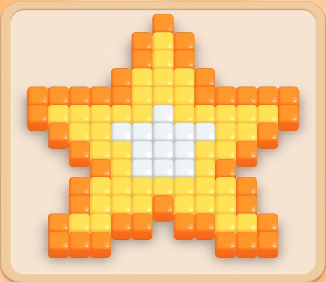
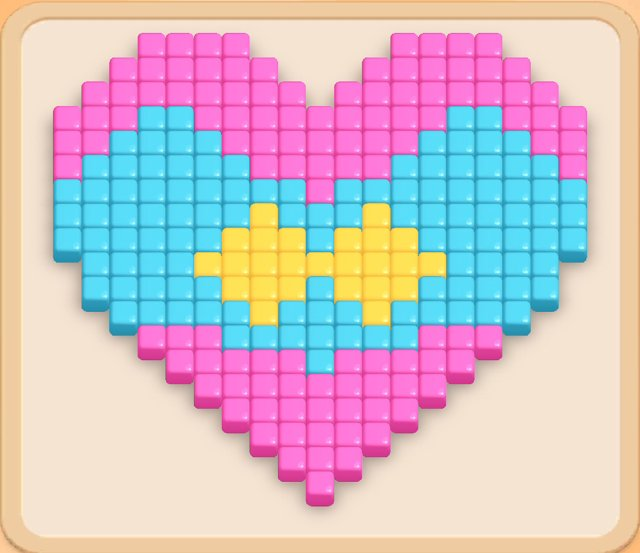
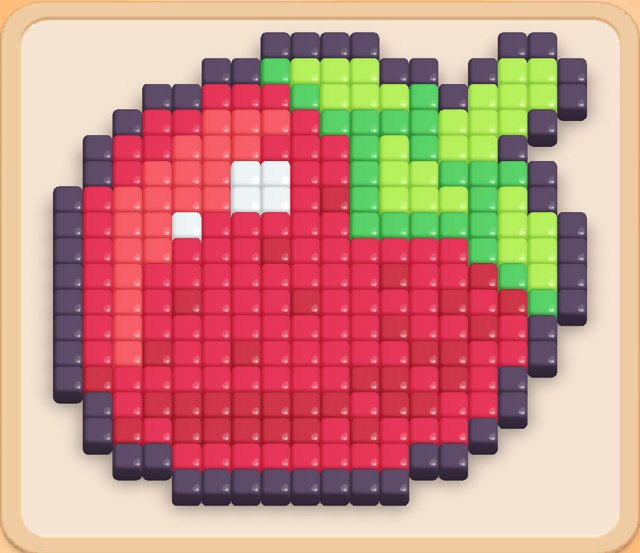
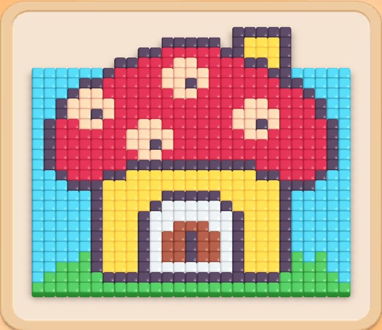
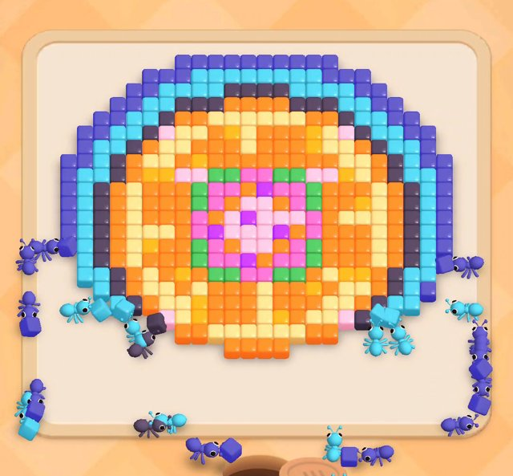
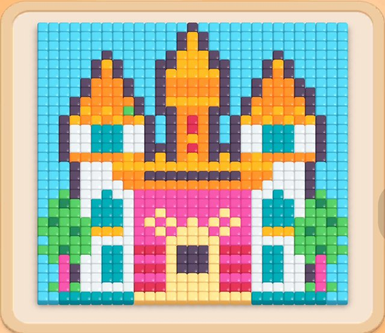

# Colony Flow: разбор каждого уровня по твоим записям и улучшения для Bloomlings

20 октября 2026. Основа: 8 твоих записей экрана (Pixel 9, Colony Flow v1.0.79, около 11,5 минут), на которых пройдены L1, L2, L3, L4, L5 (Hard) и L10 (Super Hard, проигрыш и победа). Предыдущие обзоры: [глубокий разбор и план](colony-flow-deep-study-2026-10-20.md), [исследование 19.10](colony-flow-study-2026-10-19.md), [аудит наших 2500 уровней](gameplay-vs-colony-flow-2026-10-18.md).

## Коротко

1. **Первые четыре уровня Colony Flow проиграть нельзя, и они этого не скрывают.** Я перенёс поля и очереди их L1–L4 в наш движок правил и проверил полным перебором всех вариантов игры: любая последовательность тапов выигрывает (для L4 это 335 тысяч состояний). Наши L1–L4 устроены так же. Разница в другом: у них L4 — поле 27×26 из 637 клеток, 8 цветов, 24 капсулы и 85 секунд работы; у нас — 12×12 и 5 капсул.
2. **Их L5 Hard действительно трудный: случайные тапы выигрывают 27,4%** (точный расчёт по 38 934 состояниям). Если тапать «любой цвет, который сейчас виден на поле», побед 61%. Если всегда брать крайнюю левую или крайнюю правую колонку, проигрыш 100%. Наш L5 Hard: 79,8% случайными тапами и 100% «по видимому цвету». Роковая ошибка у них случается рано, на 4–6-м тапе.
3. **Их L10 Super Hard: случайные тапы — 17,9%** (232 927 состояний), «по видимому цвету» — **11%**, то есть очевидная стратегия хуже случайной. Наш L10 Super Hard: 67,4% и 100%.
4. **Главный механизм — остаток цвета в глубине.** Цвет капсулы лежит частью снаружи, частью за другими слоями. Капсула съедает внешнюю часть, а остаток (2–30 клеток) занимает слот и ждёт.
   - На L10 у тебя жёлтая 30 простояла **85 секунд** в победной партии и всю проигрышную партию не двинулась ни разу.
   - Тёмно-зелёная 2 простояла 75 секунд.
   - На L5 кремовая 2 стояла 42 секунды.
5. **Второй механизм — копание очереди и запас слотов.** Нужный цвет лежит под капсулой, которой сейчас нечего делать. Чтобы до него добраться, нужен свободный слот под «парковку».
   - Твой проигрыш L10: в последний свободный слот ушла розовая 25 без работы, и всё встало.
   - Победа L10 из того же положения: оранжевая 30. Она могла работать, открыла белую 49, а белая — всё остальное.
6. **Количества в капсулах в сумме ровно равны клеткам каждого цвета:** 870 из 870 на L10, 484 на L5, 637 на L4. Но отдельные капсулы не совпадают с областями картинки, и именно поэтому возникают остатки. У нас капсулы обычно подогнаны под доступную работу и маленькие.
7. **Сложность у них растёт размером, цветами и глубиной, а не новыми объектами.** От L1 к L10 механика одна: «?» в очереди. Цветов 3 → 3 → 6 → 8 → 10 → 11, клеток 99 → 248 → 267 → 637 → 484 → 870, капсул 9 → 9 → 12 → 24 → 18 → 29. Колонок всегда 3.
8. **Обучение минимальное:**
   - L1: подсказка «Tap a box…» и сразу «Use Speed Up» (ускорение ×2 бесплатно на 20 минут, с таймером);
   - L3: обязательное открытие доп. слота;
   - L5: плашка «HARD LEVEL»;
   - L10: «SUPER HARD LEVEL».

   Больше ничего не объясняют, всё понятно из картинки.
9. **Чего у них нет и что мы можем сделать лучше:**
   - разбора, почему проиграл;
   - честной подсказки про цвета в глубине;
   - различимых оттенков: светло-розовый рядом с розовым, жёлтый рядом с оранжевым, голубой рядом с бирюзовым.

   При этом есть жизни, продолжение за 900 монет, «Fail Offer» за $5.99 и рекламный баннер во время игры на L10.
10. **Муравьи** (раздел 10). Каждая капсула выпускает ~4 муравья в секунду, ходьба ~9 клеток/с — это мы уже повторили. Но у них счётчик падает при выходе муравья, а слот освобождается сразу после выхода последнего. У нас — при прибытии и после всей волны, поэтому дорога лишний раз держит слот.
11. **Что делать нам.** Перенести в ядро и генератор три вещи: капсулы с остатком в глубине, цветов больше, чем слотов, и проверку, что очевидная стратегия проигрывает. Это измеримо тем же движком, на котором я считал их уровни. Пример ниже: одна и та же картинка из нашего пилота даёт от 100% до 17% случайных побед в зависимости только от очереди, а предложенный L5 даёт 54% случайными тапами и 77% по видимому цвету.

## 1. Откуда данные и насколько им верить

| Что | Как получено | Надёжность |
|---|---|---|
| Поля (схемы ниже) | Кадр начала уровня, автоматическое распознавание сетки кубиков и цветов (скрипт `gridmap.py`, общий с прошлым разбором обложек). L5 взят с обложки фан-сайта, а 8 клеток под водяным знаком восстановлены по видео | Сверено с очередями: суммы капсул каждого цвета **совпали с числом клеток** на L1, L2, L3, L4, L10 точно. На L5 одна клетка светло-розовая/розовая перепутана, исправлено |
| Очереди | Кадры области слотов и очереди каждую секунду. Колонки восстановлены целиком по мере того, как капсулы поднимались вверх | Высокая: все суммы сходятся. На L4 первая зелёная капсула (24) вычислена по сумме, на L5 четыре первых тапа пришлись на разрыв между записями |
| Ходы и слоты | Покадрово, с точностью ±1 с. Несколько тапов в одну секунду упорядочены по тому, в какой слот попала капсула | Средняя по времени, высокая по составу |
| Симулятор | Движок правил нашего пилота v4 с доступом со всего периметра поля (у Colony Flow муравьи обходят всю рамку) и 5 слотами. Терпеливый игрок: каждый тап доигрывается до конца, прежде чем следующий | **Проверка движка:** на наших curated L1–10 он дал точно те же вероятности, что настоящее ядро Bloomlings в аудите 18.10 (L5 = 79,8%, L10 = 67,4%) |
| Скрытые «?» на L10 | В симуляторе считаются известными | Для ботов это верхняя граница: в игре они знают ещё меньше |

Ограничения:
- Связки, ключи, двери и шоколад на этих уровнях не встречаются, это L15+.
- Реальное время в Colony Flow (несколько капсул одного цвета одновременно, игрок тапает, пока муравьи бегут) в симуляторе упрощено до «доиграть и решать дальше».
- Наш симулятор не знает о бустерах.

## 2. Как читать схемы

- **Поле:** одна буква — одна клетка, верх схемы — верх поля, `.` — пустая клетка. Буквы подобраны по цвету: `O` оранжевый, `Y` жёлтый, `W` белый, `#` тёмный контур и т. д. Легенда — в таблице под каждым полем.
- **Слой** — сколько раз нужно перейти на другой цвет, чтобы добраться до клетки снаружи поля. Слой 0 открыт сразу. Слой 2 значит, что сверху лежат ещё два разных цвета.
- **«Глубже первого слоя»** — какая доля клеток цвета лежит глубже его внешнего слоя (за внешний слой берётся первый слой, где набирается 10% клеток цвета). Это прямой показатель риска остатка: капсула съест внешнюю часть и будет ждать.
- **Очередь:** колонки слева направо, ряд 1 сверху. Тапнуть можно только верхнюю капсулу колонки. `C37` — голубая на 37 клеток.
- **Полосы слотов:** одна строка — одна капсула, один символ — 2–3 секунды. `█` — капсула в слоте и клетки уходят, `░` — капсула в слоте, но работы нет (стоит), пробел — капсулы в слоте нет.

## 3. Сводка: их L1–L10 и наши L1–L10

| | CF L1 | CF L2 | CF L3 | CF L4 | CF L5 Hard | CF L10 SH | **Наш L5 Hard** | **Наш L10 SH** |
|---|---|---|---|---|---|---|---|---|
| Картинка | звезда | сердце | яблоко | грибной домик | кольца | замок | кактус | бабочка |
| Поле | 13×13 | 19×19 | 18×18 | 27×26 | 24×24 | 29×30 | 12×12 | 12×12 |
| Клеток | 99 | 248 | 267 | 637 | 484 | 870 | 136 | 136 |
| Цветов | 3 | 3 | 6 | 8 | 10 | 11 | 3 | 3 |
| Капсул | 9 | 9 | 12 | 24 | 18 | 29 | 7 | 7 |
| Размер капсул | 4–15 | 8–38 | 5–52 | 8–50 | 5–47 | 6–58 | 16–24 | 10–32 |
| Колонок / глубина | 3 / 3 | 3 / 3 | 3 / 4 | 3 / 9 | 3 / 6 | 3 / 10 | 3 / 3 | 3 / 3 |
| Длительность у тебя | ~30 с | ~32 с | ~43 с | ~85 с | >100 с | ~2 мин (проигрыш), ~3 мин 40 с (победа) | — | — |
| Случайные тапы | 100% | 100% | 100% | 100% | **27,4%** | **17,9%** | 79,8% | 67,4% |
| «По видимому цвету» | 100% | 100% | 100% | 100% | **61%** | **11%** | 100% | 100% |
| Всегда левая колонка | победа | победа | победа | победа | **проигрыш** | **проигрыш** | победа | победа |
| Всегда правая колонка | победа | победа | победа | победа | **проигрыш** | победа | победа | победа |

Для CF L1–L5 и L10 и для наших L5 и L10 случайные тапы посчитаны точно, перебором всех состояний. «По видимому цвету» для CF посчитано по 2000 партиям, для наших L5 и L10 — из аудита 18.10 (256 партий). Наши L11+ — другая история: там случайные тапы на Hard дают в среднем 7%, но «всегда левая колонка» выигрывает 96% Hard и 97% Super Hard ([аудит](gameplay-vs-colony-flow-2026-10-18.md)).

## 4. Уровень 1 — звезда



**Поле 13×13, 99 клеток, 3 цвета.** Свободный силуэт на пустом фоне.

```
. . . . . . O . . . . . .
. . . . . O Y O . . . . .
. . . . . O Y O . . . . .
. . . . O Y Y Y O . . . .
O O O O O Y Y Y O O O O O
O Y Y Y Y Y W Y Y Y Y Y O
. O Y Y W W W W W Y Y O .
. . O Y Y W W W Y Y O . .
. . . O Y W W W Y O . . .
. . O Y Y Y Y Y Y Y O . .
. . O Y Y Y O Y Y Y O . .
. O Y Y O O . O O Y Y O .
. O O O . . . . . O O O .
```

| Символ | Цвет | Клеток | Капсулы этого цвета | Слои (слой: клеток) | Глубже первого слоя* |
|---|---|---:|---|---|---:|
| `Y` | жёлтый | 45 | 15 + 15 + 15 = 45 | 1: 45 | 0% |
| `O` | оранжевый | 42 | 14 + 14 + 14 = 42 | 0: 42 | 0% |
| `W` | белый | 12 | 4 + 4 + 4 = 12 | 2: 12 | 0% |

**Очередь — 9 капсул, 3 колонки, «латинский квадрат»:** в каждом ряду и в каждой колонке по одной капсуле каждого цвета.

```
        кол.1   кол.2   кол.3
ряд 1     O14     Y15      W4
ряд 2     Y15      W4     O14
ряд 3      W4     O14     Y15
```

**Как шла партия** (≈30 с от старта до экрана победы):
- 0 с: затемнение, рука на оранжевой 14 и подсказка «Tap a box to place into the slot». Других объяснений нет.
- 2 с: оранжевая 14 (кол. 1). Муравьи выбегают из норки внизу, обходят рамку и едят оранжевый контур звезды.
- 3–5 с: жёлтая 15 (кол. 1) и жёлтая 15 (кол. 2). Жёлтый под оранжевым, и он открывается по мере того, как уходит контур.
- 7 с: оранжевая 14 закончилась, слот свободен. За 5 секунд одна капсула съела 14 клеток.
- 9–12 с: белые 4 (кол. 1 и кол. 3). Белая серединка — слой 2.
- 12 с: затемнение и рука на кнопке «×2»: «Use Speed Up to make ants go faster!». Ускорение включается с таймером 20:00.
- 14–21 с: оставшиеся четыре капсулы. Одновременно занято не больше 4 слотов.
- ~25 с: поле пустое; 32 с: «Victory!», +20 монет, два муравья-маскота.

**Симулятор:** любая последовательность выигрывает, полный перебор — 140 состояний.

**Что делает уровень:**
1. Показывает основной цикл одним жестом: тап → капсула в слот → муравьи несут кубики → число падает → слот освобождается.
2. Сразу видно «снаружи внутрь»: контур → заливка → серединка. Это три слоя, и каждый следующий цвет открывается только после предыдущего, но проиграть нельзя.
3. Подсказка про ×2 появляется уже на первом уровне. Они продают темп, а не только решение.

**Наш L1 для сравнения** — росток 11×12, 2 цвета (вода 88, лист 34), 3 капсулы 44/44/34, 2 колонки, вход одной аркой снизу:
```
. . W W W W W W W . .
. W W W W W W W W W .
W W W W W W W W W W W
W W L L W W W L L W W
W L L L L W L L L L W
W L L L L L L L L L W
W W L L L L L L L W W
W W W W L L L W W W W
W W W W W L W W W W W
W W W W W L W W W W W
W W W W W L W W W W W
. . W W W W W W W . .
```
У нас 72% поля — фон, который съедают две одинаковые капсулы. У них фона нет вовсе: каждая клетка — часть звезды, и три цвета дают три фазы.

**Что взять:**
- В L1 должно быть не меньше трёх цветов, вложенных друг в друга, на пустом фоне вокруг силуэта. Фон на L1 не нужен.
- 9 капсул по 4–15 в 3 колонки, чтобы игрок успел сделать много коротких тапов и увидеть, как работает очередь.
- Подсказка про ускорение уже на L1 (у нас бесплатная настройка 3× без таймера — это плюс, и его надо показать).

## 5. Уровень 2 — сердце



**Поле 19×19, 248 клеток, 3 цвета.** Площадь ×2,5 по сравнению с L1.

```
. . . P P P P . . . . . P P P P . . .
. . P P P P P P . . . P P P P P P . .
. P P P P P P P P . P P P P P P P P .
P P P C C P P P P P P P P P C C P P P
P P C C C C P P P P P P P C C C C P P
P C C C C C C P P P P P C C C C C C P
C C C C C C C C C P C C C C C C C C C
C C C C C C C Y C C C Y C C C C C C C
C C C C C C Y Y Y C Y Y Y C C C C C C
. C C C C Y Y Y Y Y Y Y Y Y C C C C .
. C C C C C Y Y Y C Y Y Y C C C C C .
. . C C C C C Y C C C Y C C C C C . .
. . . P P P C C C C C C C P P P . . .
. . . . P P P P P C P P P P P . . . .
. . . . . P P P P P P P P P . . . . .
. . . . . . P P P P P P P . . . . . .
. . . . . . . P P P P P . . . . . . .
. . . . . . . . P P P . . . . . . . .
. . . . . . . . . P . . . . . . . . .
```

| Символ | Цвет | Клеток | Капсулы этого цвета | Слои (слой: клеток) | Глубже первого слоя* |
|---|---|---:|---|---|---:|
| `C` | голубой | 112 | 37 + 38 + 37 = 112 | 0: 112 | 0% |
| `P` | розовый | 111 | 37 + 37 + 37 = 111 | 0: 111 | 0% |
| `Y` | жёлтый | 25 | 8 + 9 + 8 = 25 | 1: 25 | 0% |

**Очередь: ряд розовых, ряд голубых, ряд жёлтых.**

```
        кол.1   кол.2   кол.3
ряд 1     P37     P37     P37
ряд 2     C37     C38     C37
ряд 3      Y8      Y9      Y8
```

**Как шла партия** (35 → 67 с, ≈32 с):
- 36–37 с: три розовые 37 подряд. Розовые верх и низ сердца открыты сразу.
- 37–44 с: два слота свободны, но ты ждёшь, пока розовые работают.
- 45 и 47 с: голубые 37 и 38. Теперь все 5 слотов заняты, но **все работают**: полный ряд сам по себе не проигрыш.
- 53 с: жёлтая 8. Жёлтый в середине, слой 1, он открылся, когда голубые прогрызли пояс.
- 61–62 с: последние жёлтая 9, голубая 37 и жёлтая 8. Конец около 66 с.
- Розовые 37 работали по 15–16 секунд каждая. Две из трёх простояли с остатком 4 около 5 секунд: последние розовые клетки нижнего острия открылись позже.

**Симулятор:** 100% при любой игре (295 состояний).

**Что делает уровень:**
1. Крупные капсулы (37–38) и долгая работа — слот надолго занят.
2. Один цвет в двух отдельных областях (верх и низ сердца): первые знаки остатка.
3. Пять заполненных слотов без проигрыша учат, что проигрывает не «полный ряд», а «полный ряд, где никто не работает».

**Что взять:** второй уровень уже в 2,5 раза больше первого. Мы держим 11–12×12 до L10, а потом прыгаем на 24×24. Нужен рост на каждом уровне.

## 6. Уровень 3 — яблоко: контур, блик и доп. слот



**Поле 18×18, 267 клеток, 6 цветов.** Уже есть тёмный контур, два оттенка красного (малиновый и лососевый блик) и два зелёных (лайм и зелёный).

```
. . . . . . . # # # # . . . . # # .
. . . . . # # G L L L # # . # L L #
. . . # # R R R G L L L G # L L L #
. . # R R s s s R G G G G L L L # .
. # R R s s s R R R G L G L L # . .
. # R s s s W W R R G L L G G G # .
# R s s s s W W R R G L L L G L # .
# R s s W R R R R R G G G G G L L #
# R s s R R R R R R R R R R G L L #
# R s R R R R R R R R R R R R G L #
# R s R R R R R R R R R R R R R G #
# R s R R R R R R R R R R R R R # .
# R s R R R R R R R R R R R R R # .
# R R R R R R R R R R R R R R # . .
. # R R R R R R R R R R R R R # . .
. # R R R R R R R R R R R R # . . .
. . # # R R R R R R R R # # . . . .
. . . . # # # # # # # # . . . . . .
```

| Символ | Цвет | Клеток | Капсулы этого цвета | Слои (слой: клеток) | Глубже первого слоя* |
|---|---|---:|---|---|---:|
| `R` | малиновый | 136 | 52 + 18 + 16 + 50 = 136 | 1: 136 | 0% |
| `#` | тёмный контур | 54 | 26 + 28 = 54 | 0: 54 | 0% |
| `L` | лайм | 28 | 28 = 28 | 1: 22, 2: 6 | 21% |
| `G` | зелёный | 23 | 13 + 10 = 23 | 1: 21, 2: 2 | 9% |
| `s` | лососевый (блик) | 21 | 11 + 10 = 21 | 2: 21 | 0% |
| `W` | белый | 5 | 5 = 5 | 2: 5 | 0% |

**Очередь — 12 капсул, 4 ряда.**

```
        кол.1   кол.2   кол.3
ряд 1     #26     #28     s10
ряд 2     s11     R18     R50
ряд 3     R52     L28      W5
ряд 4     G13     R16     G10
```

**Как шла партия** (76 → ≈125 с, ≈43 с от первого тапа):
- 76–80 с: окно «открыт бустер» и рука на «+1 слот». Слот добавлен, играем на 6.
- 82–83 с: тёмные 26 и 28 (кол. 1 и 2) — контур. Муравьи обходят рамку и прогрызают тёмный ободок со всех сторон.
- 87 с: лососевая 11 (кол. 1). **15 секунд стоит на 11**: лососевый — это блик внутри красного, слой 2.
- 90 с: малиновая 18 (кол. 2), 95 с: малиновая 52 (кол. 1).
- 96–98 с: зелёная 13, лайм 28, лососевая 10. **Заняты все 6 слотов**, все работают, кроме лососевой.
- 104–108 с: малиновые 16 и 50.
- 112–119 с: слот свободен, но сверху лежит только белая 5 (тоже блик, слой 2), и ты ждёшь. 120 с: белая 5, 121 с: зелёная 10.
- ≈125 с: конец, +20 монет.

**Симулятор:** 100% даже без доп. слота, на 5 слотах (1104 состояния).

**Что делает уровень:**
1. Контур — «первая дверь». Пока тёмный ободок не съеден, красного нет.
2. Блик внутри — первый «цвет в глубине». Капсула блика, взятая рано, стоит.
3. Первый бустер выдаётся обязательно на уровне, где он не нужен. Игрок узнаёт его без стресса.

**Что взять:** контур и светлый блик с L3, а не с L8 или L20, как в нашем каталоге или в пилоте v4. Бустер давать на уровне, где он безопасен, а не после проигрыша.

## 7. Уровень 4 — грибной домик: «большая работа» без риска



**Поле 27×26, 637 клеток, 8 цветов.** Небо, трава, тёмный контур, красная шляпка с персиковыми пятнами, жёлтые стены, белая и коричневая дверь.

```
. . . . . . . . . . . . . . . . . # # # # # . . . . .
. . . . . . . . . . . # # # # # . # Y Y Y # . . . . .
. . . . . . . . . # # R R R R R # # Y Y Y # . . . . .
. . . . . . . # # R R R p p R R R R # # Y # . . . . .
C C C C C C # R R R R p p p p R R R R R # # C C C C C
C C C C # # R R R R R p p # p R R R R R R # # C C C C
C C C # p p R R R R R R p p R R R R R R R R R # C C C
C C # p p p p R R R R R R R R R R R p p R R R R # C C
C C # p p # p R R R R R R R R R R p p p p R R R # C C
C # R R p p R R R p p R R R R R R p p # p R R R R # C
C # R R R R R R p p p p R R R R R R p p R R R R R # C
C # R R R R R R p p # p R R R R R R R R R R R R R # C
C # R R R R R R R p p R R R R R R R R R R R R R R # C
C # R R R R R R # # # # # # # # # # # R R R R R R # C
C C # R R R # # Y Y Y Y Y Y Y Y Y Y Y # # R R R # C C
C C C # # # Y Y Y Y Y Y Y Y Y Y Y Y Y Y Y # # # C C C
C C C C C # Y Y Y Y Y # # # # # Y Y Y Y Y # C C C C C
C C C C C # Y Y Y Y # W W W W W # Y Y Y Y # C C C C C
C C C C C # Y Y Y # W W W W W W W # Y Y Y # C C C C C
C C C C C # Y Y Y # W W b b b W W # Y Y Y # C C C C C
C C C C C # Y Y Y # W b b # b b W # Y Y Y # C C C C C
C C C C C # Y Y Y # W b b # b b W # Y Y Y # C C C C C
C C C C G # Y Y Y # W b b # b b W # Y Y Y # G C G C C
C C G G G # Y Y Y # W W W W W W W # Y Y Y # G G G C C
C G G G G G # # # # # # # # # # # # # # # G G G G G C
G G G G G G G G G G G G G G G G G G G G G G G G G G G
```

| Символ | Цвет | Клеток | Капсулы этого цвета | Слои (слой: клеток) | Глубже первого слоя* |
|---|---|---:|---|---|---:|
| `R` | красный | 165 | 15 + 50 + 15 + 35 + 35 + 15 = 165 | 1: 165 | 0% |
| `C` | голубой | 126 | 30 + 32 + 32 + 32 = 126 | 0: 126 | 0% |
| `#` | тёмный контур | 125 | 25 + 35 + 40 + 25 = 125 | 0: 25, 1: 69, 2: 17, 3: 14 | 80% |
| `Y` | жёлтый | 87 | 10 + 19 + 8 + 50 = 87 | 1: 7, 2: 80 | 0% |
| `G` | зелёный | 46 | 22 + 24 = 46 | 0: 46 | 0% |
| `p` | персиковый | 44 | 44 = 44 | 2: 44 | 0% |
| `W` | белый | 29 | 14 + 15 = 29 | 2: 29 | 0% |
| `b` | коричневый | 15 | 15 = 15 | 3: 15 | 0% |

Тёмный контур — 80% клеток глубже внешнего слоя: он обводит не только домик снаружи, но и дверь внутри. Жёлтый — 92%: стена за контуром. Отсюда и долгие остатки.

**Очередь — 24 капсулы, колонки 9/9/6.**

```
        кол.1   кол.2   кол.3
ряд 1     R15     R15     G24
ряд 2     C30      Y8     R15
ряд 3     #25     C32     C32
ряд 4     R50     C32     #25
ряд 5     Y10     #40     W15
ряд 6     #35     R35     Y50
ряд 7     p44     G22        
ряд 8     Y19     R35        
ряд 9     W14     b15        
```

**Как шла партия** (запись `level-4~2`, ≈84 с; первая зелёная 24 тапнута до начала записи):

```
t, с           ||    |    |    |    |    |    |    |    |  
зелён 24       |███                                        
красн 15       | ░░░░░████████████                         
голуб 32       | █████                                     
тёмн 25        | █████                                     
красн 15       |     ░█████████                            
голуб 30       |      █████                                
тёмн 25        |       ████                                
бел 15         |       █████                               
жёлт 50        |           ██████████                      
красн 15       |            ████████████                   
жёлт 8         |              ██                           
красн 50       |              ░█████████████████           
жёлт 10        |                 █████                     
голуб 32       |                 ██████                    
тёмн 35        |                        ██████             
голуб 32       |                        ███████            
перс 44        |                        ███████████████    
жёлт 19        |                         ████████          
бел 14         |                                  ████     
тёмн 40        |                                  ███████  
красн 35       |                                  ██████   
зелён 22       |                                   ████    
красн 35       |                                      ████ 
корич 15       |                                        ░
```

- 2–3 с: красная 15, голубая 32 и тёмная 25 из правой колонки. Голубая и тёмная сразу работают.
- **Красная 15 стоит на 15 с 2-й по 14-ю секунду**: красная шляпка за контуром. Потом ползёт: 11 → 5 → 3 → конец около 35 с. Капсула на 15 клеток держала слот 33 секунды.
- 15–20, 28–30, 35–40, 51–58, 70–75 с: все пять слотов заняты, но всё работает.
- 41–48 и 63–68 с: слоты свободны, ты ждёшь: сверху лежали тёмная 35 и голубая 32, потом белая 14 и тёмная 40.
- Персиковая 44 (пятна на шляпке, слой 2) последние 8 клеток делала 12 секунд.
- 81 с: последняя капсула, коричневая 15 (дверь, слой 3).

**Симулятор:** проиграть **нельзя**. 100% при случайных тапах, полный перебор 335 103 состояний. Все боты выигрывают.

**Что делает уровень.** Это не задача, а «первая большая картинка». Много фаз (небо → контур → шляпка → стены → дверь), заметные остатки и полторы минуты удовольствия от работы муравьёв. Риска нет. Твой замер 91 с и мои 85 с совпадают.

**Что взять:** нормальный уровень может быть нерешаемо простым, если он большой, красивый и показывает фазы картинки. Наш L4 (скворечник 12×12, 5 капсул) на это не похож.

## 8. Уровень 5 — кольца, HARD LEVEL



Перед уровнем плашка «HARD LEVEL», весь интерфейс фиолетовый. **Поле 24×24, 484 клетки, 10 цветов.** Кольца снаружи внутрь: фиолетовое → голубое → тёмное → большой диск из оранжевого, кремового и жёлтого → в центре розовый, светло-розовый, зелёный и пурпурный.

```
. . . . . . . V V V V V V V V V V . . . . . . .
. . . . . V V V C C C C C C C C V V V . . . . .
. . . . V V C C C C # # # # C C C C V V . . . .
. . . V V C C # # # O O O O # # # C C V V . . .
. . V V C C # O O c c c c c c O O # C C V V . .
. V V C C # l c c O Y c O O O Y c l # C C V V .
. V C C # O c c O O O c O O O Y c c O # C C V .
V V C # O c c O Y O O O O O O O O c c O # C V V
V C C # O Y Y l l G G P P G G l l Y c O # C C V
V C # O c O O O G P P O M P P G O O O c O # C V
V C # O c O O O G P O l l O P G O O Y c O # C V
V C # O c O O O P O l M l l P P O c c c O # C V
V C # O c c c O l M l l l M O P O O O c O # C V
V C # O c Y O O G P O l l O P G O O O c O # C V
V C # O c O O O G P P M O P P G O O O c O # C V
V C C # O c O Y O G G P P G G O c Y Y O # C C V
V V C # O c c O c O O O c O O Y O c c O # C V V
. V C C # O c c Y O O O c O O O c c O # C C V .
. V V C C # l c Y O O O c Y O c c l # C C V V .
. . V V C C # O O c c c c c c O O # C C V V . .
. . . V V C C # # # O O O O # # # C C V V . . .
. . . . V V C C C C # # # # C C C C V V . . . .
. . . . . V V V C C C C C C C C V V V . . . . .
. . . . . . . V V V V V V V V V V . . . . . . .
```

| Символ | Цвет | Клеток | Капсулы этого цвета | Слои (слой: клеток) | Глубже первого слоя* |
|---|---|---:|---|---|---:|
| `O` | оранжевый | 117 | 34 + 35 + 35 + 13 = 117 | 3: 40, 4: 33, 5: 35, 6: 3, 7: 6 | 66% |
| `V` | фиолетовый | 92 | 45 + 47 = 92 | 0: 92 | 0% |
| `C` | голубой | 88 | 45 + 43 = 88 | 1: 88 | 0% |
| `c` | кремовый | 59 | 25 + 18 + 16 = 59 | 3: 17, 4: 40, 5: 2 | 71% |
| `#` | тёмный | 52 | 27 + 25 = 52 | 2: 52 | 0% |
| `P` | розовый | 20 | 20 = 20 | 4: 2, 5: 2, 6: 16 | 90% |
| `l` | светло-розовый | 19 | 19 = 19 | 3: 4, 5: 4, 6: 11 | 79% |
| `Y` | жёлтый | 16 | 16 = 16 | 4: 10, 5: 5, 6: 1 | 38% |
| `G` | зелёный | 16 | 16 = 16 | 5: 8, 6: 8 | 50% |
| `M` | пурпурный | 5 | 5 = 5 | 5: 1, 6: 1, 7: 3 | 80% |

Внешние три кольца лежат каждое в одном слое. **Все цвета диска разбросаны на 3–5 слоёв:** оранжевый на 66% глубже своего внешнего слоя, кремовый на 71%, розовые на 79–90%. Любая капсула цвета из диска будет стоять с остатком.

**Очередь — 18 капсул, по 6 в колонке.**

```
        кол.1   кол.2   кол.3
ряд 1     c25     #25     P20
ряд 2     G16     V45     C45
ряд 3     #27      M5     O35
ряд 4     l19     Y16     O13
ряд 5     c18     O35     c16
ряд 6     O34     V47     C43
```

Сумма каждого цвета точно равна числу клеток: 92, 88, 52, 117, 59, 20, 19, 16, 16, 5.

**Как шла партия** (запись обрывается на 103-й секунде, уровень не закончен):

```
t, с           ||    |    |    |    |    |    |    |    |    |    |  
тёмн 25 сл.1   |████                                                 
голуб 45 сл.4  |████                                                 
роз 20 сл.3    |░░░░░░░░░░░██████████████████████                    
оранж 35 сл.2  | ██████████                                          
крем 25 сл.1   |     █████                                           
зелён 16 сл.1  |          █████████████░██████░███                   
тёмн 27 сл.2   |          ████████░░░░░█████░███░░███░█████████████  
оранж 13 сл.4  |                  ███                                
крем 16 сл.5   |                   ████████░░░░░░░░░░░░░░░░░░░██     
голуб 43 сл.4  |                     ███████████████████████████████ 
пурп 5 сл.1    |                                     ██░░░░░░░░░███░ 
жёлт 16 сл.3   |                                      ██░░░░░░░░░░██ 
оранж 35 сл.5  |                                                ████ 
фиол 47 сл.2   |                                                  ██
```

- Первые четыре тапа пришлись на разрыв записи: тёмная 25, фиолетовая 45, розовая 20, голубая 45.
- **Розовая 20 простояла на 20 больше 23 секунд**: розовое в самом центре. Потом 36 секунд ползла по клетке и закончилась на 64-й секунде.
- Зелёная 16 (центр) взята на 20-й секунде, жила 47 секунд, с остатками 2 и 1 ещё 10 секунд.
- Тёмная 27 (кольцо, слой 2, открывается кусками) — 80 секунд, по клетке за 3–4 секунды.
- **Кремовая 16: с 52-й по 94-ю секунду остаток 2** — 42 секунды держала слот ради двух клеток.
- Пурпурная 5 (центр): остаток 2 с 75-й по 98-ю секунду. Жёлтая 16: остаток 7 с 78-й по 102-ю.
- **Все пять слотов заняты с 42-й по 63-ю и с 76-й по 94-ю секунду.** Ничего нельзя нажать, муравьи ползают по одному.
- На 103-й секунде в очереди ещё 113 клеток работы.

**Симулятор:**

| Стратегия | Победы |
|---|---|
| Случайные тапы (точно, 38 934 состояния) | **27,4%** |
| Случайный из «цветов, которые видны на поле» | 61% |
| Всегда левая колонка / всегда правая | 0% / 0% |
| Левая из видимых цветов | 0% |
| Больше всего работы прямо сейчас | 0% |
| Самая большая капсула видимого цвета | 100% |

**Где проигрывают:** в 300 случайных партиях роковой тап (после которого победа уже невозможна) пришёлся на **4–6-й ход** в 213 из 217 проигрышей. Чаще всего это тёмная 27 (66 раз), зелёная 16 (40), оранжевая 35 (32), пурпурная 5 (27). Ошибка в начале уровня проявляется через минуту, когда слоты забиты остатками.

**Что делает уровень:**
1. Ровно то, ради чего игру хвалят: картинка сама задаёт загадку. Нужно понять, что центр откроется последним, и не брать центральные цвета рано.
2. Ошибка ранняя, а проявляется поздно. Это и делает ретрай интересным: игрок вспоминает, что взял розовую слишком рано.
3. Новых объектов нет. Только глубина и количество цветов (10 на 5 слотов).

**Наш L5 Hard для сравнения** — кактус 12×12, 3 цвета (лист 48, вода 50, горшок 38), 7 капсул 16–24, вход аркой снизу. Случайные тапы 79,8%, «по видимому цвету» 100%:
```
. W W W W L L W W W W .
. W W W L L L L W W W .
W L L W L L L L W L L W
W L L W L L L L W L L W
W L L L L L L L L L L W
W W L L L L L L L L W W
W W W W L L L L W W W W
W W W W L L L L W W W W
T T T T T T T T T T T T
W T T T T T T T T T T W
W W T T T T T T T T W W
. . T T T T T T T T . .
```
Три цвета на пять слотов: держать «по одному каждого» можно всегда.

## 9. Уровень 10 — замок, SUPER HARD LEVEL



Плашка «SUPER HARD LEVEL», интерфейс красный. Внизу во время игры появляется рекламный баннер. **Поле 29×30, 870 клеток, 11 цветов.**

```
S S S S S S S S S S S S S S # S S S S S S S S S S S S S S
S S S S S S S S S S S S S # Y # S S S S S S S S S S S S S
S S S S S S S S S S S S S # Y # S S S S S S S S S S S S S
S S S S S S # S S S S S # Y Y Y # S S S S S # S S S S S S
S S S S S # Y # S S S # # Y Y Y # # S S S # Y # S S S S S
S S S S S # O # S S S # Y Y Y Y Y # S S S # O # S S S S S
S S S S # O O O # S S # O O O O O # S S # O O O # S S S S
S S S S # O O O # S S # O O O O O # S S # O O O # # S S S
S S S # O O O O O # S # Y Y Y Y Y # S # O O O O O # S S S
S S S # Y O Y O G # S # # O O O # # S # Y O Y O Y # S S S
S S # Y O Y O Y O Y # S # O R O # S # Y O Y O Y O Y # S S
S S # W W T T T W W # S # O R O # S # W W T T T W W # S S
S S # W W T T T W W # S # O Y O # S # W W T T T W W # S S
S S # W W T T T W W # # # O R O # # # W W T T T W W # S S
S S # O O O O O Y O # Y # O Y O # Y # O Y O O O O O # S S
S S S # W W W Y Y Y Y Y Y Y Y Y Y Y Y Y Y Y W W W # S S S
S S S # W W W O O O # # # # # # # # # O O O W W W # S S S
S S S # W W W W O O O O O O O O O O O O O W W W W # S S S
S S G # W W T W W P P P P P P P P P P P W W T W W # G S S
S G g G W T T T W P P P P P P P P P P P W T T T W G g G S
S G G G W T T T W P P c P P P P P c P P W T T T W G G G S
G g G G G T T T W P c P c P c P c P c P W T T T G G G g G
G G G g G Y Y Y W P P c P c c c P c P P W Y Y Y G g G G G
S G G G G W W W W P P P c c c c c P P P W W W W G G G G S
G G g G G W T T W R R R c # # # c R R R W T T W G G g G G
S G P G W W T T W P P P c # # # c P P P W T T W W G P G S
S S P # W W T T W R R R c # # # c R R R W T T W W # P S S
S S P # W W T T W P P P c c c c c P P P W T T W W # P S S
S G P G W W W W W R R R c c c c c R R R W W W W W G P G S
S S T T T T T T T c c c c c c c c c c c T T T T T T T S S
```

| Символ | Цвет | Клеток | Капсулы этого цвета | Слои (слой: клеток) | Глубже первого слоя* |
|---|---|---:|---|---|---:|
| `S` | голубой (небо) | 243 | 40 + 40 + 37 + 40 + 40 + 40 + 6 = 243 | 0: 237, 2: 6 | 2% |
| `#` | тёмный контур | 112 | 10 + 57 + 45 = 112 | 0: 1, 1: 102, 3: 9 | 8% |
| `W` | белый | 104 | 20 + 49 + 35 = 104 | 1: 80, 2: 24 | 23% |
| `O` | оранжевый | 88 | 30 + 58 = 88 | 2: 82, 3: 4, 4: 2 | 7% |
| `P` | розовый | 69 | 24 + 25 + 20 = 69 | 1: 67, 3: 2 | 3% |
| `T` | бирюзовый | 68 | 25 + 43 = 68 | 0: 14, 1: 20, 2: 16, 3: 18 | 79% |
| `Y` | жёлтый | 60 | 30 + 30 = 60 | 1: 19, 2: 34, 3: 7 | 68% |
| `G` | зелёный | 53 | 25 + 28 = 53 | 0: 46, 1: 6, 2: 1 | 13% |
| `c` | кремовый | 44 | 22 + 22 = 44 | 0: 36, 2: 8 | 18% |
| `R` | красный | 21 | 6 + 15 = 21 | 1: 18, 3: 3 | 14% |
| `g` | тёмно-зелёный | 8 | 8 = 8 | 1: 8 | 0% |

Что важно в этой картинке:
- **Небо `S`** открыто сразу почти целиком (237 из 243), но 6 клеток лежат за другими цветами. Последние голубые капсулы получат остаток (в твоих партиях голубые 40 заканчивались на 2 и 1).
- **Тёмный контур `#`** обводит весь замок (слой 1), поэтому до внутренностей не добраться, пока его не съесть. Но тёмные капсулы лежат глубоко в очереди: 10 и 57 в средней колонке, 45 в правой.
- **Бирюзовый `T`** размазан по 4 слоям, 79% глубже внешнего. Это почти гарантированный остаток.
- **Жёлтый `Y`** на 68% глубже внешнего слоя: шпили и пояс за оранжевым.
- **Белый `W`** (стены) на слое 1–2 и открывает остальное. Это «ключевой» цвет.

**Очередь — 29 капсул, из них 10 скрытых «?»**, которые раскрываются, когда становятся верхними:

```
        кол.1   кол.2   кол.3
ряд 1     S40     S40     S40
ряд 2      g8     S37     S40
ряд 3     Y30     T43     S40
ряд 4     c22      R6     Y30
ряд 5     W20     #10     P20
ряд 6     O30     P24     O58
ряд 7     W49     G28     W35
ряд 8     T25     P25     c22
ряд 9     G25     #57     #45
ряд 10            R15      S6
```

Скрытыми были: в кол. 1 жёлтая 30, оранжевая 30, белая 49 и бирюзовая 25; в кол. 2 голубая 37, тёмная 10 и розовая 24; в кол. 3 голубая 40 (третья), белая 35 и кремовая 22.

**Две партии рядом** (полосы — ключевые капсулы):

```
ПРОИГРЫШ
t, с           ||         |         |         |        
голуб 40 ×5    | ██████████                            
т-зелён 8      |        ░░░░░░░░░░░░░░███░░░░░███░░░░░░
жёлт 30        |         ░░░░░░░░░░░░░░░░░░░░░░░░░░░░░░
крем 22        |         ████                          
бирюз 43       |            ██░░░█████░░░░░░░░░░░░░░░░░
красн 6        |            █                          
голуб 40 (6-я) |              ██████████████           
тёмн 10        |               ██                      
бел 20         |                ███                    
роз 24         |                    ████░░░░░░░░░░░░░░░
зелён 28       |                            ███        
роз 25 ✗       |                                      ░
ПОБЕДА
t, с           ||         |         |         |         |         |         |         |   
голуб 40 ×5    |█████████                                                                 
голуб 40 (6-я) |     █████████████████                                                    
бирюз 43       |         ███░░░░░░░░░░░░██░░██░░░░░░░░░░░░█████                           
красн 6        |          ░░░░░░░░░░░░██                                                  
тёмн 10        |          ██                                                              
т-зелён 8      |                ░░░░░░░░░░░░░░░░███░░░░░░░░░░░░░░░░░░░░░░░██              
жёлт 30        |                ░░░░░░░░░░░░░░░░░░░░░░░░░░░░░██████████                   
крем 22        |                      ███                                                 
бел 20         |                        ███                                               
роз 24         |                              ███░░░░░░░░░░░░░░░░░░████                   
зелён 28       |                              ████                                        
оранж 30 ★     |                                       ██████████████                     
бел 49 ★       |                                                  ██████                  
остальные 12   |                                                        ██████████████████
```

**Проигрыш (≈115 с, 16 тапов):**
1. 5–17 с: пять голубых 40/37 — небо уходит за 12 секунд (десятки муравьёв, около 3 клеток в секунду на капсулу).
2. 24–27 с: тёмно-зелёная 8, жёлтая 30, кремовая 22. **Жёлтая 30 не сдвинулась до конца партии.** Тёмно-зелёная 8 простояла 45 секунд, потом остаток 2.
3. 35–49 с: бирюзовая 43 (дальше застряла на 29, потом на 13), красная 6, голубая 40, тёмная 10, белая 20.
4. 60 с (часть 2, 6 с): розовая 24 — съела 14 и встала на 10. **С этого момента все 5 слотов заняты.**
5. 39–59 с второй части: один слот свободен, в слотах тёмно-зелёная 2, жёлтая 30, бирюзовая 13 и розовая 10, и никто не работает. Сверху лежат оранжевая 30, розовая 25 и жёлтая 30.
6. **Тап 16: розовая 25** (под ней тёмная 57, нужная для контура). Розовой работы нет, и через полсекунды «Out of slots» → «Fail Offer $5.99» → «Level Failed». На экране проигрыша 4 сердца и таймер восстановления 17:37.

**Победа (≈220 с, 29 тапов):**
- Первые 15 тапов — **тот же набор капсул**, только в другом порядке: бирюзовую, красную и тёмную взял раньше тёмно-зелёной, жёлтой и кремовой.
- Пришёл **в ту же позицию**: в слотах тёмно-зелёная 2, жёлтая 30, бирюзовая 13, розовая 10 и один свободный; сверху оранжевая 30, розовая 25, жёлтая 30. Здесь ты простоял около 14 секунд.
- **Тап 16: оранжевая 30.** Она могла работать (оранжевые шпили открылись), и под ней раскрылась **белая 49**.
- Оранжевая медленно открыла путь, ожили бирюзовая и жёлтая, бирюзовая закончилась, и на освободившийся слот ушла белая 49. Белые стены сняли блок с розовой и тёмно-зелёной.
- После 165-й секунды осталось 12 капсул, и они прошли без остановок.

**Симулятор:**

| Стратегия | Победы |
|---|---|
| Случайные тапы (точно, 232 927 состояний) | **17,9%** |
| Случайный из видимых цветов | **11%** |
| Всегда левая колонка | 0% |
| Самая большая капсула видимого цвета | 0% |
| Всегда правая колонка / левая из видимых / больше всего работы сейчас | 100% |

При игре «по видимому цвету» 274 из 300 партий проигрывают. **Роковой тап — на 10–11-м ходу: розовая 24 (129 раз) или тёмно-зелёная 8 (110 раз).** Это ровно твоя ошибка: и в проигрыше, и в победе тёмно-зелёная 8 и розовая 24 стали капсулами, которые держали слот больше минуты. В победной партии тебя спасло то, что запас слотов остался ровно на оранжевую.

Любопытно: на L10 есть простые стратегии, которые выигрывают всегда («всегда правая колонка»). Человек их не видит, потому что очередь в 10 рядов и 10 скрытых капсул.

**Что делает уровень:**
1. Первый раз появляется «ключевой цвет» (белый): пока не взял его в нужный момент, всё стоит.
2. Скрытые «?» не дают просчитать очередь до конца, но верхняя капсула всегда известна. Удача тут вторична.
3. Проигрыш объясним. В момент проигрыша в слотах ровно те капсулы, которые взяты рано, и последний тап очевидно лишний.

**Наш L10 Super Hard для сравнения** — бабочка 12×12, 3 цвета (цветок 42, вода 40, бутон 54), 7 капсул 10–32. Случайные тапы 67,4%, «по видимому цвету» 100%:
```
. V V V V . . V V V V .
V F F V V W W V V F F V
V F F V V W W V V F F V
V V V V V W W V V V V V
W V V V V W W V V V V W
W V V V W W W W V V V W
W V F V W W W W V F V W
W V V V W W W W V V V W
W W W W W W W W W W W W
F F F F F F F F F F F F
F F F F F F F F F F F F
. . F F F F F F F F . .
```

## 10. Муравьи: как выходят, как быстро и от чего это зависит

Кадры: [L1 — первая капсула по 0,2 с, часть 1](colony-flow-2026-10-20/owner-video/ants-l1-first-pod-1.jpg) и [часть 2](colony-flow-2026-10-20/owner-video/ants-l1-first-pod-2.jpg), [L1 — момент, когда освобождается слот](colony-flow-2026-10-20/owner-video/ants-l1-slot-frees.jpg), [L10 — пять голубых капсул сразу, часть 1](colony-flow-2026-10-20/owner-video/ants-l10-five-pods-1.jpg) и [часть 2](colony-flow-2026-10-20/owner-video/ants-l10-five-pods-2.jpg), [L1 — включение ×2](colony-flow-2026-10-20/owner-video/ants-l1-speed-up.jpg).

Состояние кнопки ×2 я проверил на каждой записи: она зелёная (включена) только в конце L1, после обучающей подсказки. На L2, L3, L4, L5 и L10 кнопка серая, то есть **все замеры ниже, кроме отдельно отмеченного, сделаны на 1×.** Включённое ×2 на следующий уровень не переносится.

### 10.1 Хронология одной капсулы (L1, оранжевая 14, 1×)

| Время | Что происходит |
|---|---|
| 2,3 с | Тап |
| 2,4 с | Капсула уже в слоте: перелёт из очереди ~0,1–0,2 с |
| 2,8 с | Счётчик 14 → 13, муравья на экране ещё не видно |
| 3,0 с | 13 → 12, первый муравей вылезает **из самой капсулы в слоте** и идёт вверх |
| 3,0–6,4 с | Счётчик падает на 1 каждые ~0,25 с (12, 11, 10 … 1). Муравьи идут цепочкой по одному, вертикально вверх от своего слота |
| 4,2 с | Первый муравей у края звезды поднимает первый кубик. **От тапа до первой снятой клетки ~1,9 с** |
| 4,8–6,2 с | Муравьи с кубиками на спине несут их в **норку** под полем и исчезают в ней |
| 6,6 с | Счётчик 0, капсула пустая |
| 6,8–7,0 с | Капсула улетает из слота |
| 7,2 с | **Слот свободен**, хотя последние оранжевые муравьи ещё несут кубики (до ~8,4 с) |

### 10.2 Пять капсул сразу (L10, голубые 40, 1×)

| Время | Счётчики пяти слотов |
|---|---|
| 1,6 с | Первая 40 в слоте |
| 2,0 с | 39, 40, 40 (ещё две приземлились) |
| 2,8 с | 36, 37, 38, 37, 40 — все пять слотов заняты |
| 4,0 с | 32, 33, 34, 33, 37 |
| 5,0 с | 29, 30, 30, 30, 34 |
| 6,5 с | 24, 25, 25, 25, 29 |

- **Каждая капсула выпускает муравьёв в своём темпе, ~3,3–4 в секунду,** независимо от того, сколько капсул работает. Пять капсул дают в сумме ~16–20 муравьёв в секунду.
- Муравьи каждой капсулы идут своей колонной вверх к нижнему краю рамки, там расходятся влево и вправо и бегут **по дорожке внутри рамки вокруг всего поля**. К 6,5 с они уже у верхнего края.
- **Скорость ходьбы около 9 клеток в секунду** (левый край поля, ~30 клеток, проходят примерно за 3 с).
- Капсула на 40 клеток при широком фронте опустошается за ~10–12 с.

### 10.3 Правила, которые видны на кадрах

1. **Счётчик — это сколько муравьёв ещё не вышло, а не сколько клеток ещё лежит.** Он падает в тот момент, когда муравей выходит за конкретной клеткой. Сама клетка исчезает позже, через 1,5–3 с, когда муравей до неё дойдёт.
2. **Муравей выходит, только если есть открытая клетка его цвета, на которую ещё никто не идёт.** Нет такой клетки — никто не выходит, счётчик стоит, капсула «спит» в слоте. Так появляются твои «жёлтая 30 стоит 85 секунд» и «кремовая 2 стоит 42 секунды».
3. **Новые клетки открываются, когда другой муравей поднимает кубик, который их закрывал.** Отсюда цепочки: оранжевый муравей снимает кубик контура, и сразу из жёлтой капсулы выходит муравей за открывшейся жёлтой клеткой. Так работают «слои» из таблиц выше.
4. **Слот освобождается почти сразу после выхода последнего муравья** (~0,4–0,6 с на анимацию улёта), не дожидаясь, пока муравьи донесут кубики. Время жизни капсулы в слоте ≈ количество ÷ темп выхода + ожидание открытых клеток. Длина дороги до клетки на занятость слота не влияет.
5. **Несколько капсул одного цвета.** Пока открытых клеток много, все работают параллельно, каждая в своём темпе (L2: три розовые 37 одновременно 34/36/37 → 31/33/35). Когда клеток мало, их получает капсула, поставленная раньше (L2, 47–51 с: розовые 6, 10, 13 — уменьшается только первая).
6. **Узкий фронт — медленно.** Если открыта одна-две клетки цвета, выходит по муравью, когда клетка откроется. Тёмная 27 на L5 и голубая 43 на L10 шли по клетке за 3–4 с: это давление Hard, а не тормоза.
7. **×2 (L1, 15–17 с).** Темп выхода растёт примерно до 6–7 муравьёв в секунду (оранжевая 14: 14 → 11 → 9 за 0,8 с), ходьба тоже ускоряется. Правила не меняются, меняется только время.
8. **Полный ряд из пяти работающих капсул — не проигрыш.** Проигрыш наступает, только когда ни из одной капсулы не может выйти ни один муравей (раздел 9, «Out of slots»).

### 10.4 Как это у нас сейчас

| | Colony Flow | Bloomlings (Unity и плейтест) | Пилот v4 (HTML) |
|---|---|---|---|
| Откуда выходят | Из капсулы в слоте, цепочкой вверх | Из арок у поля (`ClearStyles`, «walkers' line from each arch») | Из входа |
| Темп выхода на капсулу | ~0,25–0,30 с между муравьями (3,3–4/с) | `LineGap = 0.3 s` (3,3/с) — почти то же, настроено по видео владельца 08.10 | До 2 курьеров на капсулу одновременно |
| Скорость ходьбы | ~9 клеток/с | `PerCell = 0.11 s` (~9 клеток/с) — то же | 10 мс на клетку туда, 8 обратно (условно) |
| Когда падает счётчик | При выходе муравья | **При прибытии**: «slot counts drop as they land» (`LevelAnimator`) | При снятии клетки |
| Когда освобождается слот | Сразу после выхода последнего муравья | В конце волны, после прибытия последнего | После возвращения последнего курьера |
| Две капсулы одного цвета | Пустеют параллельно, пока клеток хватает | Старшая забирает все доступные клетки, младшая ждёт остатка (`Settler`, FR-020) | Старшая первой |
| Дорога назад | Несут кубик в норку, слот уже свободен | — | Учитывается в занятости слота |
| ×2 | Около 20 бесплатных минут, потом за рекламу | Ускорение 3× бесплатно | Две скорости |

Темп и скорость мы уже повторили почти точно. Расходятся два правила: **когда падает счётчик и когда освобождается слот.** У нас (и ещё сильнее в пилоте v4) слот держит ещё и дорога, поэтому:
- на большом поле с далёкими клетками слоты у нас заняты дольше, чем у них, при той же задаче;
- время жизни капсулы зависит от длины маршрута, которую игрок не планирует;
- число на капсуле у них показывает «сколько ещё выйдет» и сразу говорит, есть ли работа: стоит — значит, работы нет. У нас число падает с задержкой на дорогу, и «стоит» и «идут, но ещё не дошли» выглядят одинаково.

Ядро (Core) при этом не меняется: логически клетки и так снимаются мгновенно, это вопрос показа и того, когда клиент разрешает следующий тап в слот.

## 11. Закономерности, которые видны на всех шести уровнях

1. **Точный учёт работы.** Сумма капсул каждого цвета равна числу клеток. Это у нас тоже есть (constitution).
2. **Капсулы не совпадают с областями картинки.** Одна капсула захватывает и внешнюю, и внутреннюю часть цвета, поэтому есть остаток. Внешние кольца на L5 — исключение: там цвет лежит в одном слое, и капсулы проходят без остановки. Значит, остаток — это осознанный приём для сложных мест, а не случайность.
3. **Цветов больше, чем слотов, начиная с L3:** 6, 8, 10, 11 цветов на 5 слотов. Нельзя держать по капсуле каждого цвета.
4. **Тёмный контур с L3** — «дверь» в внутренности, а на сложных уровнях его капсулы лежат глубоко в очереди.
5. **Светлые и белые блики — слой 2** почти везде. Если взять их капсулы рано, они стоят.
6. **Очередь — 3 колонки на всех уровнях до L10.** Сложность растёт глубиной колонок (3 → 4 → 9 → 6 → 10), а не их числом. Первый ряд — «приманка»: на L10 это пять голубых 40, на L4 — красные 15, которые стоят.
7. **Ошибка ранняя, проигрыш поздний.** На L5 роковой тап — 4–6-й, проигрыш наступает минутой позже. На L10 — 10–11-й тап, а «Out of slots» через полторы минуты.
8. **Полный ряд — не проигрыш.** Проигрыш — это «полный ряд и никто не работает». Игрок много раз видит полный ряд без беды, и это учит.
9. **Темп как часть игры.** На широком фронте капсула на 40 клеток уходит за 12 секунд. На узком — по клетке за 3–4 секунды. Долгое ожидание с полными слотами — это и есть давление Hard.
10. **Нормальный уровень может быть нерешаемо простым** (L1–L4 = 100%), если он большой и красивый. Сложность нужна только на размеченных уровнях.
11. **Обучение — один-два экрана**, бустеры открываются там, где не нужны (доп. слот на L3), остальное понятно из картинки.
12. **Монетизация бьёт в момент проигрыша:** «Out of slots — 900 монет» и рядом «Fail Offer $5.99». Жизни (сердца с таймером), реклама баннером во время уровня.

## 12. Улучшения для Bloomlings — в деталях

### 12.1 Правила ядра

| # | Что | Почему (по записям) | Как сделать | Как проверить |
|---|---|---|---|---|
| 1 | **Проигрыш = все слоты заняты и никто не может работать.** Полный ряд, где хоть одна капсула работает, — не проигрыш | Так у них. Игрок много раз видит полный ряд без беды и учится различать «плотно» и «тупик» | В Core правило уже такое (`StatusEvaluator`, FR-025: Jammed проверяется только в неподвижной точке). Проверить клиент: окно проигрыша не должно появляться, пока курьеры ещё несут работу | Тест: 5 полных слотов, у одной капсулы есть доступная клетка → уровень продолжается |
| 2 | **Экран «Почему не получилось»** после проигрыша: показать ход, после которого победа стала невозможной, и какие капсулы стояли с остатком | У них этого нет, а ошибка ранняя (4–6-й и 10–11-й ход) и проявляется поздно: игроку трудно понять, что было не так | Инструмент «первая необратимая ошибка» уже есть в разборе плейтестов (`tools/gameplay-pilot-v2/review.mjs`). Перенести в Core как сервис: решатель с бюджетом проверяет префиксы партии. На экране: «На 5-м ходу ты взял розовую 20 — её клетки в центре, она простояла 40 секунд» и подсветка этих клеток | На записанных проигрышах L5 и L10 сервис находит тот же ход, что анализ выше. Время ответа < 300 мс на телефоне |
| 3 | **«?» в очереди раскрывается, когда становится верхней** | Подтверждено записью L10 | Поправка FR-035/Mystery, как в пилоте v4. Сейчас Core раскрывает при отправке | Golden-replay на пилоте |
| 4 | **Связка держит оба слота до конца пары** | Видно на кадрах L1000 фан-сайта. На твоих уровнях связок ещё нет — проверить на записи L15+ | Пилот v4 уже реализовал (co-reservation), перенести в Core | 375 транскриптов пилота уже проверены адаптером |
| 5 | **Одна клетка — один материал** на новых уровнях. Скрытые слои клетки на больших полях убрать | У них клетка одна. Наши скрытые слои на icons-полях добавляют незнание, но не решения | Генератор: `layers=1` для новых уровней. Слои — отдельная поздняя механика (если вообще нужна) | Валидатор отклоняет многослойные клетки до выбранного уровня |
| 6 | **Доступ: решить, арки или периметр** | У них муравьи обходят всю рамку, и внешний слой картинки доступен сразу со всех сторон. У нас одна-две арки, и всё решает то, что лежит у арки | Вариант A (ближе к CF, понятнее): дорожка вокруг поля, вход — норка-арка, доступ со всего периметра. Вариант B (наше отличие): 1–3 арки, тогда картинка должна учитывать, откуда идут курьеры | Вопрос владельцу (раздел 14). Пока не решено, генерировать под один вариант нельзя |
| 7 | **Счётчик = муравьи, которые ещё не вышли; слот свободен после выхода последнего** (раздел 10) | Так у них: время в слоте не зависит от длины дороги, а стоящее число честно значит «работы нет» | Только клиент: `LevelAnimator` / Unity — уменьшать число при выходе Bloomling, отпускать слот после выхода последнего (с анимацией улёта ~0,4 с), дорогу назад и снятие клетки доигрывать уже без слота. Core не меняется | На записи L1: от тапа до свободного слота у оранжевой 14 ~4,9 с при 1×. Наш клиент на том же поле и числе должен давать ±10% |

### 12.2 Генератор: как делать сложность «как у них»

Алгоритм, проверяемый тем же движком, что посчитал их уровни:

1. **Картинка и слои.** Для каждого цвета считаем распределение клеток по слоям (как в таблицах выше).
2. **Разбивка на капсулы.** Каждый цвет делим на капсулы по 20–50 клеток, иногда маленькая 4–10, которая быстро освобождает слот. **Капсулу не подгоняем под область:** для Hard хотя бы у двух цветов капсулы должны захватывать клетки из разных слоёв.
3. **Цветов больше, чем слотов:** на Hard не меньше 7 цветов при 5 слотах, на Super Hard не меньше 8.
4. **Очередь из 3 колонок,** глубина 6–10. Первый ряд — приманка: то, что выглядит полезным (большая капсула видимого цвета), не должно быть безопасным маршрутом.
5. **Копание:** хотя бы раз нужный цвет (контур или «ключевой») лежит под капсулой, которая в этот момент не может работать.
6. **Отбор по метрикам.** Генерируем много вариантов очереди и оставляем те, что попали в окно класса (таблица ниже). Подбор вслепую не работает: в эксперименте ниже случайные CF-подобные очереди дали окно Hard лишь в 1 случае из 150.

**Окна классов** (откалиброваны по их уровням, а не по моему вкусу):

| Класс | Ориентир | Случайные тапы | По видимому цвету | Простые стратегии (левая, правая, больше работы, крупная видимая) | Дополнительно |
|---|---|---|---|---|---|
| Обучение / Normal ранний | CF L1–L4 | 100% допустимо | 100% | могут выигрывать | Растущий размер, ≥ 3 цветов, 3 фазы картинки, 30–90 секунд |
| Normal | — | ≥ 70% | ≥ 85% | — | ≥ 1 эпизод остатка (капсула стоит ≥ 10 с), чтобы игра не была пустой |
| Hard | CF L5 | 20–40% | 45–70% | **не меньше двух из четырёх проигрывают** | Роковые ходы в первой трети уровня; ≥ 2 цвета с остатком в глубине |
| Super Hard | CF L10 | 10–25% | ≤ 25% | не меньше двух из четырёх проигрывают | «Ключевой» цвет; копание; **решаемо при любом раскладе скрытых «?»** |

Последнее требование — наше преимущество: в отзывах про них главная жалоба на Super Hard — «решает удача» из-за скрытых капсул.

**Эксперимент «та же картинка, другая очередь».** Я взял картинки нашего пилота v4 (L18 «Грибной домик», 7 цветов, и L19 «Цветок в горшке», 7 цветов), оставил поле, вход и правила (вход снизу, 5 слотов) и сгенерировал по 150 CF-подобных очередей:

| Картинка пилота | Решаемых очередей из 150 | «Нельзя проиграть» (случайные 100%) | Окно Hard (случайные 12–35%, видимые ≤ 45%, левая и правая проигрывают) | Лучший вариант Hard |
|---|---:|---:|---:|---|
| L18 «Грибной домик» | 150 | 56 | 1 | случайные 17%, видимые 31%, 25 капсул |
| L19 «Цветок в горшке» | 150 | 58 | 1 | случайные 15%, видимые 33%, 31 капсул |

Очередь лучшего варианта для L18 (`B` фон, `P` розовый, `C` голубой, `D` тёмный, `V` сливовый, `G` зелёный, `A` янтарный):

```
        кол.1   кол.2   кол.3
ряд 1     B37     B26     P40
ряд 2     P41     P23     C25
ряд 3      P5     B35     P49
ряд 4     B48     V35     D39
ряд 5      B4     G20     D47
ряд 6     B44      D6     C30
ряд 7     B12      D9     B32
ряд 8     B33     A14     B31
ряд 9     C43                
```

Для сравнения: в самом пилоте v4 у L18 случайные тапы выигрывают 25%, у L19 — 9%. Эти очереди в пилоте подбирались отдельно.

Вывод: одна и та же наша картинка даёт от «нельзя проиграть» до сложности между их L5 и L10 в зависимости только от очереди. Но попасть в окно Hard случайно трудно, нужен отбор, и именно это должен делать генератор.

### 12.3 Предложение: наш L5 — первая задача на глубину

Схема (20×20, наши материалы: `W` вода Drop — фон, `D` тёмный контур Twig, `P` розовые лепестки Bloom, `R` красные серединки лепестков Bloom, `Y` янтарная сердцевина, `L` стебель Sprig). Две арки снизу. 6 цветов на 5 слотов.

```
W W W W W W W W W W W W W W W W W W W W
W W W W W W W D D D D D D W W W W W W W
W W W W W W D P P P P P P D W W W W W W
W W W D D D P P R R R R P P D D D W W W
W W D P P P D P R R R R P D P P P D W W
W D P P R R P D P R R P D P R R P P D W
W D P R R R R P D D D D P R R R R P D W
W D P R R R P D Y Y Y Y D P R R R P D W
W W D P P P D Y Y Y Y Y Y D P P P D W W
W W W D D D Y Y Y D D Y Y Y D D D W W W
W W D P P P D Y Y Y Y Y Y D P P P D W W
W D P R R R P D Y Y Y Y D P R R R P D W
W D P R R R R P D D D D P R R R R P D W
W D P P R R P D P R R P D P R R P P D W
W W D P P P D P R R R R P D P P P D W W
W W W D D D P P R R R R P P D D D W W W
W W W W W W D P P L L P P D W W W W W W
W W W W W W W D D L L D D W W W W W W W
W W W W W W W W W L L W W W W W W W W W
W W W W W W W W W L L W W W W W W W W W
        ^                     ^
        арка                  арка
```

Клеток: вода 154, контур 78, розовый 78, красный 56, янтарный 26, стебель 8 (400). Очередь — 23 капсулы, подобрана поиском по окну «случайные 35–65%, видимые ≥ 75%»:

```
        кол.1   кол.2   кол.3
ряд 1      D8     W19     R24
ряд 2      W7     D36     W23
ряд 3     P39      W4      W6
ряд 4     R21      R4      Y8
ряд 5     Y18      D5     D29
ряд 6      L8     W40      P8
ряд 7     W23      R7      W9
ряд 8     W23     P31        
```

| Стратегия | Победы |
|---|---|
| Случайные тапы (400 партий) | 54% |
| По видимому цвету | 77% |
| Всегда левая / всегда правая колонка | проигрыш / проигрыш |

Почему работает:
- Лепестки разделены тёмными прожилками.
- Розовый и красный есть и во внешних лепестках, и во внутренних.
- Янтарная сердцевина за контуром.
- Роковые ходы в случайных партиях (127 проигрышей из 300) приходятся на 7–11-й тап. Чаще всего это красные 4 и 21, тёмная 5 и янтарные 8 и 18: красный внутренних лепестков и сердцевина, взятые раньше, чем открыт контур, стоят с остатком.

Это эскиз, проверенный движком (решаемость и боты), а не готовый уровень: картинку надо дорисовать художником, а уровень — пройти на телефоне.

### 12.4 Первые 10 уровней: эволюция «иконки → цвета» с героями

| L | Поле | Вид клетки | Цветов | Герой / новое | Капсул (размер) | Колонки × глубина | Метка | Цель по метрикам |
|---|---|---|---:|---|---|---|---|---|
| 1 | 13×13 силуэт без фона | Крупная иконка героя на цвете | 3 | Sprig и Drop: тап → герой несёт свой материал; подсказка про ×3 | 9 (4–15) | 3×3 | — | 100% |
| 2 | 17×17 | Иконка | 3 | Bloom; один цвет в двух областях | 9–10 (8–35) | 3×3 | — | 100% |
| 3 | 19×19 | Иконка | 5 | Twig и тёмный контур; светлый блик (слой 2); обязательное открытие доп. слота | 12 (5–40) | 3×4 | — | 100% |
| 4 | 24×24, на всё поле | Маленькая иконка | 6–7 | Первая «большая картинка» на 60–90 секунд: фон, контур, фазы | 18–22 (8–50) | 3×6–7 | — | 100% |
| 5 | 20–24 | Цвет + значок | 6 | **Первая задача на глубину** (как 12.3) | 18–24 (4–40) | 3×6–8 | Challenge | случайные ~50%, видимые ≥ 75% |
| 6 | 24×24 | Цвет + значок | 7 | Второй оттенок героя (мох Sprig); Return | 20 (8–50) | 3×7 | — | ≥ 90% |
| 7 | 24×26 | Цвет, значок только на капсуле | 7 | Daily Reward; длинная работа | 20–24 | 3×7–8 | — | ≥ 90% |
| 8 | 26×26 | Цвет | 7 | «Пузырь Drop»: «?» в глубине очереди, верхняя всегда видна | 22 | 3×8 | — | ≥ 80% |
| 9 | 26×28 | Цвет | 8 | Bloom Burst; «ключевой цвет» (белый открывает остальное) | 22–24 | 3×8 | — | ≥ 80% |
| 10 | 28×30 | Цвет | 8–9 | **Первый настоящий Hard** | 26–30 (6–55) | 3×9–10 | Hard | окно Hard |

Почему так:
- Иконки остаются, пока поле меньше ~24 клеток по стороне. Когда иконка уже не читается, символ героя переезжает на капсулу. Это твоя идея, и она совпадает с тем, что требует размер поля.
- Каждый герой приносит свой материал и свою механику (подробно в разделе 6.3 [плана](colony-flow-deep-study-2026-10-20.md)): Drop — «пузырь» и туман, Bloom — гирлянда-связка и бутоны, Sprig — мостик и грядки, Twig — ключи и ящики.
- Hard на L5 у них есть, но наш L5 будет мягче (Challenge без ярлыка): мы не продаём бустеры через стресс на пятом уровне. Первый Hard — L10, и он должен быть настоящим.

### 12.5 Картинки

| Что видно у них | Что делать нам |
|---|---|
| С L3 тёмный контур и светлые блики. Пары оттенков одного тона (два красных, два зелёных, два розовых) | Палитра уровня из материалов героев: 8–12 к L20, контур с L3, белый/жемчуг с L3–4, оттенки одного тона с заметной разницей по светлоте (ΔL ≥ 20) и знаком на капсуле |
| Каждая клетка — кубик со светом | У нас уже «мягкие кубики» (FR-044) — сохранить |
| Фон — часть сюжета (небо, трава) и тоже работа | Фон разный, не всегда голубой. На L1–3 без фона, с L4 на всё поле |
| Простые сюжеты, крупно, узнаваемо с первого взгляда | Мир Bloomlings: сад, ручей, кухня, герои в сценках. Сюжет не копировать никогда |
| Похожие оттенки путают (светло-розовый и розовый, жёлтый и оранжевый) | Проверка различимости в генераторе + режим символов на клетках |

### 12.6 Темп

| Измерено у них | Предложение |
|---|---|
| Широкий фронт: капсула 40 за ~10–12 с, пять одновременно — около 16–20 муравьёв/с | Модель курьеров пилота v4 (до 2 на капсулу и слот после возвращения) этим цифрам не соответствует: не переносить её в клиент |
| Узкий фронт: по клетке за 3–4 с | Не ускорять искусственно: медленный остаток — это давление Hard |
| Уровень 30 с (L1) → 85 с (L4) → 2–4 мин (L5, L10) | Цели длительности по классам, отдельная метрика «секунд без доступного хода» |
| ×2 бесплатно 20 минут, потом за рекламу | Наше ускорение 3× бесплатно всегда — показать на L1 |
| Каждая капсула выпускает ~3,3–4 муравья в секунду, независимо от числа капсул; ходьба ~9 клеток/с; первая клетка снимается через ~1,9 с после тапа | Наши `LineGap 0.3 s` и `PerCell 0.11 s` уже совпадают. Оставить, проверить первую клетку ≤ 2 с на 1× |
| Выход только за открытой и не занятой клеткой; несколько капсул одного цвета — параллельно, при нехватке клеток первой получает старшая | У нас иначе: `Settler` (FR-020) отдаёт старшей капсуле все доступные клетки сразу, младшая того же цвета получает только остаток. Пока клеток много, у них две капсулы одного цвета пустеют вместе, у нас по очереди. Решить, переходим ли на их порядок (это правило ядра и solver'а, нужна поправка FR-020), или оставляем свой и учитываем его в генераторе |
| Слот свободен сразу после выхода последнего муравья | Перейти на это правило показа (12.1, строка 7) |

### 12.7 Интерфейс и честность

- **Тон интерфейса по классу**, как у них: Hard — фиолетовый, Super Hard — красный, и плашка перед стартом. У нас бейдж HARD уже есть.
- **Предупреждение «последний свободный слот»:** мягкая подсветка, когда занято 4 из 5 и у капсул в слотах нет работы. Это не подсказка хода, а честная информация о риске.
- **Подсказка на капсуле «сейчас доступно N клеток».** Опционально, в настройках доступности. У них этого нет, а их главная трудность — непонимание остатка.
- **Отмена бустера до применения.** У них нельзя, игроки жалуются.
- **Без жизней, без платного продолжения в момент проигрыша.** Сохраняем; «Fail Offer» не копируем.
- **Реклама не во время уровня.** Сохраняем наши правила (doc 10 §8).

### 12.8 Как проверять, что стало лучше

1. **Эталоны CF как внутренние тесты калибровки:** их L5 и L10, переписанные в наш формат, хранятся в инструментах (не в игре) и прогоняются ботами при каждом изменении метрик. Если наша оценка Hard не узнаёт их L5 как Hard, метрика сломана. В игру эти уровни не попадают никогда (оригинальность).
2. **Отчёт генератора по каждому уровню:** окно класса, роковые ходы (где и какие), список цветов с остатком в глубине.
3. **Плейтест на телефоне:** ты и 3–5 новых игроков, L1–L30. Метрики: проигрыши на Hard, «понял, почему проиграл» (да/нет), длительность, оценка «интересно / трудно / узнал / темп».

## 13. Порядок работ

1. Решения владельца по разделу 14.
2. Core: правила 1–5 из 12.1 + экран «почему не получилось»; клиент: правило 7 (счётчик и слот как у муравьёв).
3. Генератор: разбивка с остатком, цвета > слотов, копание, отбор по окнам, эталоны CF в тестах.
4. Первые 10 уровней по 12.4 и 30 уровней в APK, плейтест.
5. Пересборка каталога локально у владельца.

## 14. Вопросы владельцу

1. **Доступ:** периметр (как у них, внешний слой доступен со всех сторон) или наши арки? От этого зависит, как генерировать картинки.
2. **Наш L5:** мягкая первая задача без ярлыка Hard (как предлагаю) или настоящий Hard, как у них?
3. **Экран «почему не получилось»** после проигрыша — делаем?
4. **Подсказка «доступно N клеток»** на капсуле — делаем как опцию доступности или не нужно?
5. **Окна классов** из 12.2 принимаем как цели генератора?
6. **Муравьи:** число на капсуле падает при выходе Bloomling, а слот освобождается после выхода последнего, как у них? Это только показ, ядро не меняется.
7. **Две капсулы одного цвета:** пустеют параллельно, как у них (поправка FR-020, затрагивает solver), или оставляем «старшая забирает всё»?

## Приложение: файлы и воспроизведение

- Кадры и поля: `product/audits/colony-flow-2026-10-20/owner-video/`.
- Сами видео — в твоём бакете R2, в репозиторий не кладутся.
- Скрипты: `tools/colony-deep-research/` (нарезка кадров, распознавание поля, симулятор, разбивки очередей).
- Симулятор — копия правил пилота v4 с расширенным набором цветов (`cfsim/rules.cjs`), доступ со всего периметра через кольцо пустых клеток вокруг поля, 5 слотов, без бустеров. Проверка движка: наши curated L5 и L10 дают те же 79,8% и 67,4%, что аудит настоящего ядра.
