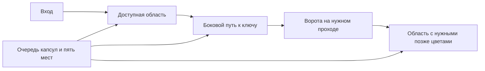

# Bloomlings: эволюция геймплея v2 — предложение

Статус: план для обсуждения, правила и опубликованные уровни пока не изменены. Основание — [аудит действующих 2500 уровней](../audits/gameplay-vs-colony-flow-2026-10-18.md). Прямое исследование Colony Flow заблокировано сетью облачной среды; расписание её открытий и конкретные решения ещё предстоит проверить. Числа ниже — наши проектные гипотезы, не измерения конкурента.

## Цель

Игрок смотрит на красивую читаемую картинку, замечает зависимость и выбирает подходящую капсулу. Часть работы идёт спокойно автоматически; несколько выборов на каждом содержательном уровне требуют внимания. После победы понятно, что именно удалось организовать.

Для этого нужны связанная геометрия картинки и очереди, осмысленные количества в капсулах, понятные препятствия и честные ошибки. Большое поле отвечает за зрелищность, длительность и пространство задачи; класс Hard отвечает за решения. Эти оси оцениваются отдельно.

Сохраняем 2500 уникальных картинок на запуск, четырёх принятых героев, последовательные уровни, пять мест ожидания, Wardrobe на L40 и генерацию каталога на компьютере владельца.

## Первые десять уровней: плавный рост и знакомство с героями

Крупный старт 11×12 сохраняется. Каждый следующий уровень чуть увеличивает число клеток; после L10 нет нынешнего скачка 12×12 → 24×24.

| Уровень | Поле | Цветов | Примерный бюджет капсул | Что усваивает игрок |
|---|---|---:|---:|---|
| 1 | 11×12 | 2 | 3–4 | Sprig и Drop: выбранный герой работает со своим цветом |
| 2 | 11×13 | 2 | 4–5 | Очистка одного участка открывает следующий |
| 3 | 12×13 | 2 | 5–6 | Разный размер капсул и свободное место |
| 4 | 12×14 | 3 | 5–7 | Знакомство с Bloom и третьим цветом |
| 5 | 13×14 | 3 | 6–8 | Первая заметная зависимость, обычный уровень |
| 6 | 13×15 | 3 | 7–9 | Небольшая капсула может закончиться сейчас, большая — остаться ждать |
| 7 | 14×15 | 4 | 8–10 | Знакомство с Twig; ненавязчивое открытие Daily Reward |
| 8 | 14×16 | 4 | 8–11 | Выбор порядка при нескольких цветах, без декоративного ключа |
| 9 | 15×17 | 4 | 9–12 | Короткая цепочка из двух зависимостей |
| 10 | 16×18 | 4 | 10–12 | Самостоятельная красивая картинка и доступ к лидерборду |

Бюджеты — ориентиры для ручного прототипа, а не квоты на принудительное дробление зарядов. Точное количество определяется работой на поле. Первые уровни могут быть совсем простыми, но ярлыков Hard/Super Hard здесь нет.

Визуальная эволюция:

- L1–3: крупные символы цвета и короткое появление соответствующего героя.
- L4–7: цвет становится главным, значок уменьшается; герой показывает, почему освободился следующий участок.
- L8–10: формируется постоянный вид цветного поля, подсказки ещё поддерживают знакомство.
- L11+: цветные клетки по умолчанию на всех размерах. Герой/бейдж и крупный счётчик остаются на капсуле; символы на поле можно включить как помощь распознаванию.

В первой десятке закрепляем по одному основному цвету на героя. Дополнительные оттенки одного семейства вводим позже отдельным уроком, а не до завершения знакомства с четырьмя героями.

Режим рисования больше не возвращает иконки только потому, что следующая картинка меньше. Настройки символов, отображение следующего слоя и логические свойства слоя — отдельные понятия. Читаемость для нарушений цветовосприятия сохраняется; отличия не должны опираться только на близкие оттенки.

## Размеры и ритм после обучения

| Участок | Основные поля | Роль больших полей |
|---|---|---|
| 11–20 | 16×18–18×20 | Закрепление, первый настоящий Hard примерно L15–20 |
| 21–50 | 18×20–22×24 | Первые редкие 24×24, знакомство с рабочими механиками |
| 51–100 | 21×24–26×28 | Большие силуэты уже регулярно; портрет героя на L100 — отдельное событие 36×36 |
| 101–300 | 21×24–28×28, иногда 30×32 | Чередование типов задач и спокойных восстановлений |
| 301–2500 | Средние 21–26 и большие 30–36 | Сохраняем договорённость: без компактных 14×16–16×18 |

Вариативность нужна и после роста: размер не растёт бесконечно каждый уровень. Красивое крупное поле может быть спокойным Normal, а небольшое — интересным Hard. После Super Hard — облегчение. Новый механизм показывается на простом уровне и сразу закрепляется, а не накладывается впервые на Super Hard.

Первый Super Hard — ориентировочно после L40–50, когда игрок уверенно знает четыре цвета и базовые зависимости. Точную позицию выбираем по пилоту, отдельно от открытия нового механизма. Ориентировочный дальнейший ритм: Hard раз в 5–7 уровней, Super Hard раз в 12–18; не заполнять квоту слабым уровнем, просто меняя ярлык.

## Количество действий: убрать механическое дробление

| Поле / стадия | Бюджет действий для прототипа |
|---|---:|
| Обучение | 3–12 капсул |
| Небольшая основная картинка | 8–18 |
| Средняя картинка | 14–26 |
| Большая 30–36 | Обычно 20–36; исключения обосновываем |

Это стартовые диапазоны, которые проверяются по реальной длительности и решениям. Они не означают «все большие уровни обязательно 36 капсул».

Нужны количества вроде 8, 15, 25, 40, иногда более крупные пачки, когда это оправдано фоном. Большая доступная цветовая область не должна автоматически превращаться в десяток почти одинаковых капсул по 10. Число капсул выбирается после проектирования зависимостей, а не увеличивается ради Hard.

Осмысленный пример: доступно 8 зелёных клеток, следующие 12 зелёных закрыты другим цветом. Капсула 8 освобождает место сейчас; капсула 20 оставляет героя ждать. В сочетании с другими ожидающими капсулами и необходимостью освободить два места это становится решением о ёмкости, а не проверкой совпадения значков. Сам пример — схема идеи, не сертифицированная готовая level definition.

Проверяем долю повторных нажатий по одному цвету, долю полностью завершающихся капсул и число существенных выборов в начале, середине и конце уровня. Не каждое нажатие обязано быть трудным: спокойные участки нужны между решениями.

## Новая оценка сложности

Условия «есть выигрыш» и «можно намеренно проиграть» сохраняются, но их недостаточно для качества.

1. Измеряем несколько стратегий: слепые легальные тапы, крайний левый/правый столбец, обход столбцов по кругу, выбор доступного цвета, выбор большой доступной капсулы. Проверяем на отдельной выборке и seed, чтобы генератор не подстроился под одного бота.
2. Ищем реальные точки выбора: хотя бы два внешне разумных действия имеют разные последствия. Проверяем продолжения ограниченным поиском; неизвестное продолжение помечается Unknown, а не безопасным.
3. Оцениваем необходимость планировать: стоимость ожидающих капсул, доступ к следующим верхним капсулам, полезные зависимости цветов, потребность освободить место. Нагрузка буфера на одной найденной линии не равна трудности поиска решения.
4. Для Hard нужны несколько заметных решений, распределённых по прохождению; для Super Hard — их комбинация. Одно обязательное заполнение буфера в начале и затем автоматический проход не должно давать высокий класс.
5. Отдельно считаем длительность, работу и число капсул. Длинный уровень не становится трудным автоматически.
6. В отчёт валидации попадают версия политики качества, размеры выборки, уверенность, число неизвестных продолжений и признак неполных метрик. Результат старой политики не подходит для resume новой сборки.

Гипотеза для человеческого плейтеста: Normal проходят с первой попытки примерно 75–90%, Hard 35–55%, Super Hard 15–30%. Это не текущие показатели Colony Flow и не конвертация побед ботов в вероятность победы человека. Сначала небольшой тест новых игроков, затем настройка диапазонов и ритма.

На партии уровней не должно быть нынешнего перекоса, когда один фиксированный столбец решает почти все Hard/Super Hard. Просто перемешать столбцы полезно для устранения утечки, но это не создаёт новые зависимости на поле и не заменяет переработку задач.

## Механики: каждая должна менять решение

### Ключи и ворота

Ключ в первой десятке убираем. Возвращаем механизм после базового понимания цвета и очереди — ориентир L20–30. Первая демонстрация должна показывать закрытую необходимую область и понятный путь к ключу.

Рабочая структура:

Ключ лежит не за собственными воротами. Очередь требует рассчитать, какие капсулы временно оставить ждать, чтобы получить доступ к ключу и затем внутренней области. Необходимая зона должна читаться как часть рисунка, а не скрываться под случайной плашкой.

Проверка полезности: замораживаем проход закрытым и оцениваем доступную работу и решения. Ворота, которые действительно отделяют обязательную область, не позволяют полностью очистить картинку. Альтернативный обход тоже может быть задачей, если меняет расход слотов или выбор порядка; тогда это нужно доказать измерением. Ворота, удаление открытия которых ничего не меняет, в пул не попадают.

Увеличение рамки до 3×3 само по себе не исправляет проблему: в текущем аудите большинство таких крупных ворот тоже обходятся исходным решением.

### Остальные существующие механизмы

| Механизм | Решение о применении |
|---|---|
| Камень | Оставить как геометрию маршрута; проверять необходимость прохода/обхода |
| Связанная пара | После базовых зависимостей, ориентир L25–35; реально требует два места, не просто две картинки рядом |
| Слои | Ориентир L35–50; информация для необходимого решения видна, без обязательного угадывания |
| Видимая однотипная стопка | Ориентир L60–80; понятный остаток и изменённая потребность в зарядах; ограничение по размеру значка сохраняется |
| Фонтан / сундук | Только с влиянием на доступ к области, работу или маршрут, не автоматический счётчик за обязательные соседние очистки |
| Закрытый слот | Позже, ориентир L80+, с существенным выбором получения ключа |
| Mystery | Отложить до устойчивого качества обычных задач; сохранённая проверка честности обязательна |
| Связанная тройка | Поздняя вариация; появление на конкретном уровне решает пилот, а не маркетинговый список |

Каждая механика получает отдельные метрики полезности и читаемости. Ключ/счётчик, который не различим при реальном размере клетки телефона, на этот размер не ставится. На маленьких по физическому размеру клетках используем подходящие крупные многоклеточные объекты или другой тип задачи.

## Картинки

Текущие 2500 видимых сеток различны побитово. Это ещё не доказывает 2500 разных сюжетных идей или высокую художественную выразительность каждой картинки.

Сильные стороны библиотеки можно сохранить: читаемые силуэты колокольчика, банки варенья, фруктов, героев, фламинго. Часть ранних более подробных рисунков требует упрощения: например, у стопки книг и «камеры с садом» в маленькой сетке теряется предметность. Это предварительная оценка выбранных примеров, не оценка всех 2500 людьми.

Правила для нового отбора:

- 11–16 клеток: один предмет или понятный знак, 2–4 цвета, несколько крупных деталей.
- 18–24: необычная комбинация из двух узнаваемых форм: жёлудь-фонарь, лист-зонт, чашка с цветком.
- 24–30: один главный силуэт и один небольшой сюжетный акцент: кит с маленьким садом, чайник-кораблик, гриб-почтальон.
- 30–36: портреты героев и ограниченные по деталям сценки; не добавлять тонкую штриховку только потому, что появился запас клеток.

Каждый рисунок проверяется в реальном размере борда, в начале, середине и после завершения, а не только по красивому исходному атласу. Прототип критерия: не менее 4 из 5 наблюдателей узнают основной предмет за две секунды. Семантические повторы проверяются отдельно от точных дубликатов.

Палитру проверяем после игрового mapping. У главного предмета и окружения должны различаться светлота и цвет; близкие оттенки не должны сливаться после бликов и уменьшения. Четыре базовых цвета связываем с героями, последующие цвета вводим явно. Купленная одежда героя не меняет логическое значение цвета капсулы. Проверяем мягкую насыщенную палитру на телефоне: максимальная яркость каждого цвета сама по себе не делает рисунок красивее.

Геометрия картинки участвует в проектировании решения: области, границы, доступ к внутренним цветам, ключевые проходы. Полностью удалять цветной фон без проверки опасно: в нашем ядре пустой фон проходим и может открыть обход вокруг силуэта. Сначала пробуем меньше крупных фоновых капсул; отдельно экспериментируем с различием между декоративным внешним фоном и настоящими проходами.

## Герои и возможные навыки

Герои становятся понятными руководителями цветового потока: представление в обучении, реакция на освобождённый путь, короткая радость, заметная связь героя, цвета и капсулы. Для этого подходят текущие принятые модели и лёгкие существующие движения; полный пересмотр ригов сейчас не нужен.

Навыки — отдельная гипотеза после сильного базового геймплея. Например, заданное уровнем одноразовое создание прохода или раскрытие информации может породить новый тип задачи. Это потребует собственной поддержки solver и проверки честности. Не закладываем сразу четыре дерева навыков, новый RPG-слой или привязку силы к купленной одежде. Wardrobe остаётся косметическим.

## Глобальные открытия

| Функция | Предложение |
|---|---|
| Профиль, базовые герои, коллекция выигранных картинок | Понятны с начала, минимум всплывающих окон |
| Daily Reward | Сохранить примерно L7, ненавязчиво |
| Лидерборд | Сохранить L10, показать цель длинной прогрессии |
| Shop | Около L12, когда появился реальный повод использовать валюту |
| Бустеры | Обучать при понятной потребности; Return/дополнительное место — после первых настоящих заторов. Не демонстрировать четыре средства спасения до знакомства с задачей |
| Этапные награды | Сохранить шаг 25 |
| Wardrobe | Сохранить L40 и недавно согласованные открытия/цены |
| Daily Challenge | Сохранить L50, после проверки качества сложных уровней |
| Изменения окружения | Сохранить как визуальные главы, без навигационной карты |
| События | Позже, после устойчивого качества основной игры |

Конкретные уровни открытия функций Colony Flow пока не подтверждены. Наш Wardrobe L40 не выдаётся за повторение их открытия L40.

Изменение сложности изменит темп получения петалей и расход бустеров. После плейтеста перепроверяем заработок за минуту, количество бесплатных зарядов и накопление на вещи. Нельзя компенсировать искусственную сложность обязательной покупкой бустера.

## За счёт чего сделать игру привлекательнее

Первый приоритет — несколько хороших решений внутри красивого рисунка и понятная причина поражения. При заторе игрок должен видеть, какие капсулы ждут недоступный цвет, какой участок их блокирует и почему не хватает места. Одна уместная подсказка или показ зависимости после повторной неудачи полезнее немедленной цепочки предложений покупки.

Наши отличительные стороны для проверки: знакомые герои сопровождают цветовой поток; законченная необычная картинка пополняет коллекцию; заработанные петали дают видимый косметический прогресс; сложные уровни вознаграждают понимание зависимостей. Daily Challenge может предлагать отобранную задачу, которую интересно решить и обсудить. Качество этих элементов нужно сравнить с фактической версией Colony Flow после открытия доступа; сейчас это направления развития, а не доказанное превосходство.

## Порядок реализации

1. **Измерение и критерии.** Встроить независимые политики прохождения, контрфактическую проверку механизмов, корректную маркировку Unknown и версию политики в генерацию/валидацию. Сохранять существующие проверки проходимости, точного учёта и отсутствия обязательного угадывания.
2. **Вертикальный срез из 30 уровней.** Десять уровней обучения, восемь обычных примеров, шесть Hard, три Super Hard и три отдельных доказательных задачи на механики. Это выборка из разных участков будущей прогрессии, а не три Super Hard обязательно до L30. Использовать подходящие имеющиеся рисунки.
3. **Ручной плейтест.** Проверить реальное чтение цветов/счётчиков, причину поражения, темп, удовольствие от картинки. Сравнить с записанными сессиями Colony Flow, когда её материалы станут доступны. Подтвердить, что хорошие результаты ботов не получены за счёт информации, скрытой от человека.
4. **Генератор v2 и первые 100.** Планировать зависимость областей и очереди совместно; убрать шаблон выигрышного левого столбца и лишнее дробление зарядов. Проверить все Hard/Super Hard этого участка, затем ритм всего участка.
5. **Пересборка 1–2500 на компьютере владельца.** Новые версии генератора, метрик и каталога инвалидируют старые resumed-сертификаты. Прогонять партиями и сохранять отчёт качества, а не только complete=True. Сохранять 2500 самостоятельных изображений; не заполнять объём повторами сцены в разных размерах.
6. **Совместимость и выпуск.** Сохранить прогресс, валюту, покупки Wardrobe и коллекцию. Открытия для уже продвинувшихся игроков обновляются без массового повторного показа обучения; новую награду нельзя получать повторным прохождением из-за смены каталога. Обновить зависящие от старых уровней fixtures/golden replays и проверить телефонные сессии.

Переход к массовой сборке — после доказательства качества среза. Просто ещё раз запустить прежний генератор, увеличить число иконок/цветов или поднять пороги Hard недостаточно: источник проблемы останется.

## Критерий готовности среза

- В первой десятке нет фиктивных Hard/Super Hard и скачка площади поля в несколько раз.
- Игрок различает четыре героя и цвета без постоянного чтения инструкций.
- Нет универсального фиксированного порядка столбцов, проходящего почти все трудные задачи.
- На трудном уровне есть объяснимые решения; обычные уровни включают спокойные и содержательные, а не одну бесконечную проверку совпадений.
- Ворота и ключи демонстрационных уровней имеют доказанное влияние на очистку или стоимость маршрута.
- Количество капсул оправдано задачей и длительностью; большой борд не превращается автоматически в 100 нажатий.
- Предметы на картинке узнаются в физическом размере телефона.
- Нет обязательного бустера, скрытой критической информации или зависимости от скорости пальца.

Сравнение по реальным уровням Colony Flow остаётся отдельным незавершённым этапом: его критерии и ограничения описаны в аудите.
