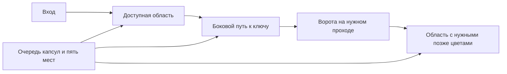

# Bloomlings: эволюция геймплея v2 — предложение

Статус: предложение, обновлённое 19 октября после [исследования доступных материалов Colony Flow](../audits/colony-flow-study-2026-10-19.md), [аудита наших 2500 уровней](../audits/gameplay-vs-colony-flow-2026-10-18.md) и уточнения роли героев и темпа роста. Изучены страницы L1–150 и поздняя выборка, изображения и серии кадров; интерактивного прохождения конкурента не было. Подготовлен отдельный [игровой пилот первых L1–30](gameplay-pilot-30.md); правила и каталог основной игры пока не заменены. Числа будущей прогрессии ниже — наши гипотезы для прототипа, не измерения конкурента.

[Визуальная версия для телефона](../previews/gameplay-evolution/index.html): девять примеров этапов, сравнение размеров, палитра героев и интерактивные схемы их влияния. HTML автономен; полный текст этого плана также включён в страницу.

[Пройти первые 30 уровней](../previews/gameplay-pilot/index.html). Это последовательный пилот с тремя Hard (L16, L23, L29) и мостиком Sprig с L25, а не прежняя выборка из разных частей будущей прогрессии. Исходный визуальный HTML остаётся сохранённым снимком концепта; требования к переносу в клиент зафиксированы в [визуальной базе](../design/visual-identity.md).

## Цель

Игрок смотрит на красивую читаемую картинку, замечает зависимость и выбирает подходящую капсулу. Часть работы идёт спокойно автоматически; несколько выборов на каждом содержательном уровне требуют внимания. После победы понятно, что именно удалось организовать.

Для этого нужны связанная геометрия картинки и очереди, осмысленные количества в капсулах, понятные препятствия и честные ошибки. Большое поле отвечает за зрелищность, длительность и пространство задачи; класс Hard отвечает за решения. Эти оси оцениваются отдельно.

Сохраняем 2500 уникальных картинок на запуск, четырёх принятых героев, последовательные уровни, пять мест ожидания, Wardrobe на L40 и генерацию каталога на компьютере владельца.

## Что уточнило сравнение с Colony Flow

1. **Палитра — часть качества картинки.** Нужны светлые детали, тёмный контур и подходящие предмету цвета. Текущий глобальный `VariantCatalog` не содержит самостоятельных белого/кремового и тёмного нейтрального каналов. Прототип палитры уровня должен предшествовать массовой переработке изображений.
2. **У связки может быть цена на всё время её работы.** В кадрах конкурента законченная окрашенная половина остаётся рядом с работающим партнёром. Логическую недоступность этого места надо подтвердить в клиенте; для нас уже имеет смысл проверить такой режим как самостоятельную механику. Сейчас наш FR-035 явно делает участников независимыми после размещения.
3. **Ключ прежде всего даёт следующий нужный ресурс.** Первая новая демонстрация связывает ключ с закрытым источником. Ворота на поле требуют отдельного доказательства полезного прохода.
4. **Счётчики разных объектов нельзя объединять по внешнему сходству.** В материалах есть коричневые препятствия, цветные дверцы и цели с остатком. Их триггер, расход зарядов и влияние на геометрию проверяются отдельно.
5. **Нужен ритм, а не постоянное усложнение.** У конкурента после новых объектов остаются уровни без них, свободные силуэты и понятные предметы. Размер и число специальных объектов не должны только расти.

Точные глобальные unlock-уровни текущей версии Colony Flow из доступных источников не установлены. Описания некоторых страниц расходятся с кадрами; соответствующие детали не переносятся в наши правила без проверки.

## Первые двадцать пять уровней: рост и знакомство с героями

Крупный старт 11×12 сохраняется. До L20 поле растёт каждый уровень: к L10 — 16×18, к L20 — 22×22, к L25 — 24×26. После L10 нет нынешнего скачка 12×12 → 24×24. Следим и за числом заполненных целей: расширение пустой рамки не считается ростом картинки. Формы остаются простыми и узнаваемыми; цвет и новые правила вводим по очереди.

| Уровень | Поле | Цветов | Примерный бюджет капсул | Что усваивает игрок |
|---|---|---:|---:|---|
| 1 | 11×12 | 2 | 3–4 | Sprig и Drop: выбранный герой работает со своим цветом |
| 2 | 11×13 | 2 | 4–5 | Очистка одного участка открывает следующий |
| 3 | 12×13 | 2 | 5–6 | Разный размер капсул и свободное место |
| 4 | 12×14 | 3 | 5–7 | Знакомство с Bloom и третьим цветом |
| 5 | 13×14 | 3 | 6–8 | Первая заметная зависимость, обычный уровень |
| 6 | 13×15 | 3 | 7–9 | Небольшая капсула может закончиться сейчас, большая — остаться ждать |
| 7 | 14×15 | 4 | 8–10 | Знакомство с Twig; ненавязчивое открытие Daily Reward |
| 8 | 14×16 | 4 | 8–11 | Выбор порядка при нескольких цветах, без декоративного ключа |
| 9 | 15×17 | 4 | 9–12 | Короткая цепочка из двух зависимостей |
| 10 | 16×18 | 4 | 10–12 | Самостоятельная красивая картинка и доступ к лидерборду |

Бюджеты — ориентиры для ручного прототипа, а не квоты на принудительное дробление зарядов. Точное количество определяется работой на поле. Первые уровни могут быть совсем простыми, но ярлыков Hard/Super Hard здесь нет.

| Уровень | Поле | Цветов | Акцент |
|---|---|---:|---|
| 11 | 17×18 | 4 | Более длинная знакомая зависимость |
| 12 | 18×18 | 5 | Светлый материал: кремовый/жемчужный; один короткий показ нового канала |
| 13 | 18×19 | 5 | Закрепление; два оттенка одного героя различаются по капсуле |
| 14 | 19×19 | 5 | Планирование порядка двух областей |
| 15 | 19×20 | 5 | Задача перед первым Hard |
| 16 | 20×20 | 5 | Первый кандидат Hard; позиция уточняется плейтестом |
| 17 | 20×21 | 5 | Более спокойное закрепление |
| 18 | 21×21 | 5 | Более крупный, но понятный силуэт |
| 19 | 21×22 | 5 | Длительность и выборы проверяются отдельно |
| 20 | 22×22 | 6 | Тёмный контур как самостоятельный материал; Normal, без новой механики |
| 21 | 22×23 | 6 | Закрепление новой палитры |
| 22 | 23×23 | 6 | Другая форма рисунка, знакомые правила |
| 23 | 23×24 | 6 | Планирование доступной работы и слотов |
| 24 | 24×24 | 6 | Обычный крупный рисунок |
| 25 | 24×26 | 6 | Кандидат первого эпизода Sprig с мостиком, отдельно от Hard |

Новый цвет означает новый канал работы, а не только новую декоративную заливку. Введение кремового и контура не требует пятого и шестого героев. Примерный ряд рисунков в HTML показывает художественное направление, не готовый сертифицированный каталог и не повторы одной картинки для заполнения соседних уровней.

Визуальная эволюция:

- L1–3: крупные символы цвета и короткое появление соответствующего героя.
- L4–7: цвет становится главным, значок уменьшается; герой показывает, почему освободился следующий участок.
- L8–10: формируется постоянный вид цветного поля, подсказки ещё поддерживают знакомство.
- L11+: цветные клетки по умолчанию на всех размерах. Герой/бейдж и крупный счётчик остаются на капсуле; символы на поле можно включить как помощь распознаванию.

В первой десятке закрепляем по одному основному цвету на героя. Дополнительные оттенки одного семейства вводим позже отдельным уроком, а не до завершения знакомства с четырьмя героями.

Режим рисования больше не возвращает иконки только потому, что следующая картинка меньше. Настройки символов, отображение следующего слоя и логические свойства слоя — отдельные понятия. Читаемость для нарушений цветовосприятия сохраняется; отличия не должны опираться только на близкие оттенки.

## Размеры и ритм после обучения

| Участок | Основные поля | Роль больших полей |
|---|---|---|
| 11–20 | 17×18–22×22, рост каждый уровень | Закрепление, первый настоящий Hard примерно L15–20 |
| 21–25 | 22×23–24×26 | Уже крупная читаемая картинка, кандидат эпизода Sprig |
| 26–50 | Обычно 22×24–26×28, отдельные 28×28 | Чередование задач и освоение полезных механизмов |
| 51–100 | Обычно 24×26–28×30, отдельные 30×32 | Большие силуэты регулярны; портрет Sprig на L100 — событие 36×36 |
| 101–300 | Средние 21–26 и большие 28–34 | Чередование типов задач и спокойных восстановлений |
| 301–2500 | Средние 21–26 и большие 30–36 | Сохраняем договорённость: без компактных 14×16–16×18 |

Вариативность нужна и после роста: размер не растёт бесконечно каждый уровень. Красивое крупное поле может быть спокойным Normal, а небольшое — интересным Hard. После Super Hard — облегчение. Новый механизм показывается на простом уровне и сразу закрепляется, а не накладывается впервые на Super Hard.

Первый Super Hard — ориентировочно после L40–50, когда игрок уверенно знает четыре цвета и базовые зависимости. Точную позицию выбираем по пилоту, отдельно от открытия нового механизма. Ориентировочный дальнейший ритм: Hard раз в 5–7 уровней, Super Hard раз в 12–18; не заполнять квоту слабым уровнем, просто меняя ярлык.

## Количество действий: убрать механическое дробление

| Поле / стадия | Бюджет действий для прототипа |
|---|---:|
| Обучение | 3–12 капсул |
| Небольшая основная картинка | 8–18 |
| Средняя картинка | 14–26 |
| Большая 30–36 | Обычно 20–36; исключения обосновываем |

Это стартовые диапазоны, которые проверяются по реальной длительности и решениям. Они не означают «все большие уровни обязательно 36 капсул» и не являются измеренным числом нажатий в Colony Flow. Среди доступных кадров есть длинные очереди; без полной записи нельзя достоверно пересчитать все нажатия.

Нужны количества вроде 8, 15, 25, 40, иногда более крупные пачки, когда это оправдано фоном. Большая доступная цветовая область не должна автоматически превращаться в десяток почти одинаковых капсул по 10. Число капсул выбирается после проектирования зависимостей, а не увеличивается ради Hard.

Осмысленный пример: доступно 8 зелёных клеток, следующие 12 зелёных закрыты другим цветом. Капсула 8 освобождает место сейчас; капсула 20 оставляет героя ждать. В сочетании с другими ожидающими капсулами и необходимостью освободить два места это становится решением о ёмкости, а не проверкой совпадения значков. Сам пример — схема идеи, не сертифицированная готовая level definition.

Проверяем долю повторных нажатий по одному цвету, долю полностью завершающихся капсул и число существенных выборов в начале, середине и конце уровня. Не каждое нажатие обязано быть трудным: спокойные участки нужны между решениями.

## Новая оценка сложности

Условия «есть выигрыш» и «можно намеренно проиграть» сохраняются, но их недостаточно для качества.

1. Измеряем несколько стратегий: слепые легальные тапы, крайний левый/правый столбец, обход столбцов по кругу, выбор доступного цвета, выбор большой доступной капсулы. Проверяем на отдельной выборке и seed, чтобы генератор не подстроился под одного бота.
2. Ищем реальные точки выбора: хотя бы два внешне разумных действия имеют разные последствия. Проверяем продолжения ограниченным поиском; неизвестное продолжение помечается Unknown, а не безопасным.
3. Оцениваем необходимость планировать: стоимость ожидающих капсул, доступ к следующим верхним капсулам, полезные зависимости цветов, потребность освободить место. Нагрузка буфера на одной найденной линии не равна трудности поиска решения.
4. Для Hard нужны несколько заметных решений, распределённых по прохождению; для Super Hard — их комбинация. Одно обязательное заполнение буфера в начале и затем автоматический проход не должно давать высокий класс.
5. Отдельно считаем длительность, работу и число капсул. Длинный уровень не становится трудным автоматически.
6. В отчёт валидации попадают версия политики качества, размеры выборки, уверенность, число неизвестных продолжений и признак неполных метрик. Результат старой политики не подходит для resume новой сборки.

Гипотеза для человеческого плейтеста: Normal проходят с первой попытки примерно 75–90%, Hard 35–55%, Super Hard 15–30%. Это не текущие показатели Colony Flow и не конвертация побед ботов в вероятность победы человека. Сначала небольшой тест новых игроков, затем настройка диапазонов и ритма.

На партии уровней не должно быть нынешнего перекоса, когда один фиксированный столбец решает почти все Hard/Super Hard. Просто перемешать столбцы полезно для устранения утечки, но это не создаёт новые зависимости на поле и не заменяет переработку задач.

## Механики: каждая должна менять решение

### Ключи и ворота

Ключ в первой десятке убираем. Возвращаем механизм после базового понимания цвета и очереди — ориентир L35–45. Первая демонстрация показывает понятный путь к ключу и закрытый источник, содержащий нужную следующую порцию ресурса. Ключ должен менять порядок действий или стоимость занятия слотов, а не только автоматически сниматься по дороге.

Для ворот на самом поле применяется отдельная структура:

Ключ лежит не за собственными воротами. Очередь требует рассчитать, какие капсулы временно оставить ждать, чтобы получить доступ к ключу и затем внутренней области. Необходимая зона должна читаться как часть рисунка, а не скрываться под случайной плашкой.

Проверка полезности: замораживаем проход закрытым и оцениваем доступную работу и решения. Ворота, которые действительно отделяют обязательную область, не позволяют полностью очистить картинку. Альтернативный обход тоже может быть задачей, если меняет расход слотов или выбор порядка; тогда это нужно доказать измерением. Ворота, удаление открытия которых ничего не меняет, в пул не попадают.

Увеличение рамки до 3×3 само по себе не исправляет проблему: в текущем аудите большинство таких крупных ворот тоже обходятся исходным решением.

### Связка с общим освобождением

В прототипе оба места возвращаются только после завершения всей пары. Закончившийся участник сохраняет видимую пустую половину соединителя и понятную подсказку о причине удержания. Вводить на спокойной демонстрации примерно L18–25, затем закрепить на разных сочетаниях цветов.

Это новый режим правил, а не исправление изображения. До включения нужны состояния удерживаемого участника, совместное завершение, корректные jam-проверки и solver, сохранение/хеширование состояния, а также однозначные действия Return и Bloom Burst. Решение о возврате всей связки или отдельном разрыве нельзя оставить случайным следствием старого кода. Старые сертификаты независимого завершения не подходят новому режиму.

Менять правило глобально для старого каталога без пересборки нельзя: оно может сделать прежние решения непроходимыми. Для сравнения в срезе можно сохранить оба режима, но игроку их различие должно быть явно видно.

### Остальные существующие механизмы

| Механизм | Решение о применении |
|---|---|
| Камень | Оставить как геометрию маршрута; проверять необходимость прохода/обхода |
| Связанная пара | Ориентир L18–25; прототип общего освобождения и наглядная цена двух занятых мест |
| Слои | Ориентир L35–50; информация для необходимого решения видна, без обязательного угадывания |
| Видимая однотипная стопка | Ориентир L60–80; понятный остаток и изменённая потребность в зарядах; ограничение по размеру значка сохраняется |
| Фонтан / сундук / цветная кормушка | Следующая итерация после основы; отдельно определить триггер, прямой расход ресурса и влияние на доступ. Не смешивать автоматический счётчик очисток и цель, которую надо кормить |
| Закрытый слот | Позже, ориентир L80+, с существенным выбором получения ключа |
| Mystery | Отложить до устойчивого качества обычных задач; сохранённая проверка честности обязательна |
| Связанная тройка | Поздняя вариация; появление на конкретном уровне решает пилот, а не маркетинговый список |

Каждая механика получает отдельные метрики полезности и читаемости. Ключ/счётчик, который не различим при реальном размере клетки телефона, на этот размер не ставится. На маленьких по физическому размеру клетках используем подходящие крупные многоклеточные объекты или другой тип задачи.

## Картинки

Текущие 2500 видимых сеток различны побитово. Это ещё не доказывает 2500 разных сюжетных идей или высокую художественную выразительность каждой картинки.

Сильные стороны библиотеки можно сохранить: читаемые силуэты колокольчика, банки варенья, фруктов, героев, фламинго. Часть ранних более подробных рисунков требует упрощения: например, у стопки книг и «камеры с садом» в маленькой сетке теряется предметность. Это предварительная оценка выбранных примеров, не оценка всех 2500 людьми.

Правила для нового отбора:

- 11–16 клеток: один предмет или понятный знак, 2–4 цвета, несколько крупных деталей.
- 18–24: необычная комбинация из двух узнаваемых форм: жёлудь-фонарь, лист-зонт, чашка с цветком.
- 24–30: один главный силуэт и один небольшой сюжетный акцент: кит с маленьким садом, чайник-кораблик, гриб-почтальон.
- 30–36: портреты героев и ограниченные по деталям сценки; не добавлять тонкую штриховку только потому, что появился запас клеток.

Каждый рисунок проверяется в реальном размере борда, в начале, середине и после завершения, а не только по красивому исходному атласу. Прототип критерия: не менее 4 из 5 наблюдателей узнают основной предмет за две секунды. Семантические повторы проверяются отдельно от точных дубликатов.

Палитру проверяем после игрового mapping. У главного предмета и окружения должны различаться светлота и цвет; близкие оттенки не должны сливаться после бликов и уменьшения. Проверяем мягкую насыщенную палитру на телефоне: максимальная яркость каждого цвета сама по себе не делает рисунок красивее.

Предлагаемый прототип разделяет логический канал и отображаемый цвет материала. Внутри уровня цвет канала един: клетка, капсула, её счётчик, цель и интерфейс показывают одно значение. Для рисунка можно подобрать тёмный контур, кремовый, красный и другие нужные тона, сохранив небольшой читаемый набор. Четыре учебные связи с героями остаются в первых десяти уровнях; переход к дополнительным материалам объясняется отдельно. Герой становится курьером материала, его принятый облик и купленная одежда не перекрашиваются вслед за каждой картинкой.

Добавление цвета материала не требует нового героя. Для среза начинаем с 2–4 каналов обучения и примерно 4–6 на основных полях; больший набор пробуем только на достаточно крупном и читаемом рисунке. Не увеличиваем одновременно число цветов, число механизмов и сложность очереди.

Проверяем эту модель на нескольких существующих сетках до решения о массовом перекрашивании. Потребуются согласованные данные клиента/генератора/коллекции и новая версия формата; старое сопоставление ролей с фиксированным цветом нельзя поменять только в рендере. Символы и другие средства распознавания сохраняются для доступности. Если новая палитра сливает два канала, такой вариант не проходит проверку.

Геометрия картинки участвует в проектировании решения: области, границы, доступ к внутренним цветам, ключевые проходы. Полностью удалять цветной фон без проверки опасно: в нашем ядре пустой фон проходим и может открыть обход вокруг силуэта. Сначала пробуем меньше крупных фоновых капсул; отдельно экспериментируем с различием между декоративным внешним фоном и настоящими проходами.

## Герои: команды материалов и эпизоды с действием

### Постоянная роль: кто выполняет работу

Капсула обозначает команду героя, которая несёт материал конкретного цвета. Число остаётся количеством работы. Например, капсула Sprig с зелёным образцом и числом 20 собирает только свой зелёный канал. Мятная капсула того же Sprig не заменяет её. Лицо или значок героя помогает узнавать команду, но точный образец материала остаётся главным признаком совпадения.

| Герой | Первое знакомство | Семейство в дальнейшем | Возможные дополнительные материалы |
|---|---|---|---|
| Sprig | L1, зелёный | Листва и растения | Мятный, лаймовый |
| Drop | L1, голубой | Вода, свет, прозрачные детали | Бирюзовый, жемчужный/кремовый |
| Bloom | L4, розовый | Цветы и плоды | Коралловый, красный, фиолетовый |
| Twig | L7, янтарный | Дерево, земля, контур | Коричневый, тёмный нейтральный |

Это правило художественного назначения команд, а не запрет художнику выбирать нужные краски. Связь нейтрального материала с командой явно задаётся в данных уровня. Образец канала един на поле, капсуле и счётчике; два одновременно активных канала не выглядят одинаково. Новые материалы вводятся постепенно: четыре основных связи до L10, светлый канал около L12, тёмный около L20, затем обычно 5–6 каналов и редкие 7–8 на подходящих крупных рисунках.

Принятый облик героев и одежда не перекрашиваются вслед за оттенком. На поле могут работать маленькие команды, а сам герой заметно участвует в отдельном эпизоде и отмечает результат. Выбранный образ сохраняется на его крупном появлении, главной и экране победы. Полный пересмотр ригов для проверки концепции не нужен.

### Роль в решении: действие является частью уровня

Рекомендация для первого прототипа — один эпизод Sprig около L25. На поле есть канал с разрывом и отмеченное место корней. Игрок нажимает на Sprig и выращивает мостик, после чего открывается маршрут к дальней области. Зелёная капсула с остатком работы получает доступ к недостающим клеткам и может освободить слот. Герой действительно меняет доступность поля.

Действие заранее предусмотрено уровнем и одинаково доступно игрокам. Это отдельный элемент задачи; платные бустеры, запасы валюты и покупки одежды на него не влияют. Игроку показываем точную область и эффект до активации. Срабатывание детерминировано, не требует реакции на время и не запускается автоматически после поражения.

Схема HTML демонстрирует только одну причинную связь: 8 зелёных единиц работы, 4 доступны сразу, 4 за каналом; мост даёт доступ ко второй четвёрке. Она не сертифицирует полный уровень. Для настоящей задачи нужно согласовать входы, пустые клетки, очереди, момент действия и стоимость ожидания в слотах. Проверка без моста должна показывать изменение доступности; отдельно проверяем, что на полном уровне действие создаёт содержательный выбор или понятный учебный шаг, а не декоративный обязательный тап.

### Варианты после проверки первого эпизода

| Герой | Возможное действие | Что меняется в задаче | Статус |
|---|---|---|---|
| Sprig | Вырастить мост в обозначенном разрыве | Доступ к новой области и время ожидания капсул | Первый прототип, кандидат около L25 |
| Drop | Смыть туман с отмеченного участка | Доступная игроку информация; клетки и количества сохраняются | Гипотеза, после проверки базовых механизмов |
| Bloom | Обменять цвета двух равных отмеченных групп | Расположение нужного ресурса при сохранении общего количества каждого цвета | Визуальный эксперимент, не требование к первому выпуску |
| Twig | Сдвинуть обозначенную деревянную преграду | Один путь открывается, другой может закрыться; важен порядок | Гипотеза, после проверки маршрутов |

Вариант «вжух и новый цвет» для Bloom проверяем только как заранее размеченную перестановку. Нельзя произвольно перекрасить клетки и оставить прежние капсулы: нарушатся баланс работы и решаемость. Визуальная схема показывает обмен четырёх розовых и четырёх зелёных клеток. Полный уровень потребует отдельной поддержки состояния, счётчиков, поиска решений и итоговой картинки коллекции.

Не вводим сразу четыре умения и отдельные деревья прокачки. Первый срез содержит команды материалов и один доказательный эпизод Sprig. Остальные действия остаются вариантами для обсуждения по результатам визуального просмотра. Wardrobe сохраняет косметическую роль и долгие цели накопления; одежда отражается в образе, а не в силе решения.

## Глобальные открытия

| Функция | Предложение |
|---|---|
| Профиль, базовые герои, коллекция выигранных картинок | Понятны с начала, минимум всплывающих окон |
| Daily Reward | Сохранить примерно L7, ненавязчиво |
| Лидерборд | Сохранить L10, показать цель длинной прогрессии |
| Shop | Около L12, когда появился реальный повод использовать валюту |
| Бустеры | Обучать при понятной потребности; Return/дополнительное место — после первых настоящих заторов. Не демонстрировать четыре средства спасения до знакомства с задачей |
| Этапные награды | Сохранить шаг 25 |
| Wardrobe | Сохранить L40 и недавно согласованные открытия/цены |
| Daily Challenge | Сохранить L50, после проверки качества сложных уровней |
| Изменения окружения | Сохранить как визуальные главы, без навигационной карты |
| События | Позже, после устойчивого качества основной игры |

Конкретные уровни открытия функций Colony Flow пока не подтверждены. Наш Wardrobe L40 не выдаётся за повторение их открытия L40.

Сохраняем текущие цены, награды за победы и регулярные бесплатные бустеры. По стандартной конфигурации регулярное выпадение начинается с L20 и повторяется через 10 уровней, кроме кратных 50, где действует отдельная система наград. Ретраи и расход ограниченных запасов — часть игры. После плейтеста новой сложности оцениваем расход и накопление, но жалоба «я застрял» сама по себе не является основанием увеличивать награды, удешевлять помощь или вводить новые раздачи.

## За счёт чего сделать игру привлекательнее

Первый приоритет — несколько хороших решений внутри красивого рисунка и понятное состояние игры. При заторе игрок должен видеть занятые места, остатки капсул и причину недоступности действия. Планировать следующую попытку и находить выигрышную последовательность остаётся задачей игрока. Автоматические подсказки или помощь после заданного числа неудач в текущий объём не добавляем.

Наши отличительные стороны для проверки: знакомые герои сопровождают цветовой поток; законченная необычная картинка пополняет коллекцию; заработанные петали дают видимый косметический прогресс; сложные уровни вознаграждают понимание зависимостей. Daily Challenge может предлагать отобранную задачу, которую интересно решить и обсудить. Сравнение доступных материалов уже показывает сильные стороны конкурента; доказать привлекательность наших отличий должен плейтест, а не только описание.

## Что проверить по отзывам игроков Colony Flow

Основание: [17 опубликованных отзывов и проверка соответствующих путей нашего кода](../audits/colony-flow-player-feedback-2026-10-19.md). Отзывы помогают найти проверяемое неудобство, но сами по себе не превращаются в требования. В приоритете три направления:

1. **Настоящая сложность и понятные правила.** Hard требует планирования и может потребовать нескольких попыток. Проверяем решаемость без обязательного бустера и понятность причин отказа в действии. Жалобы на трудный уровень не являются причиной облегчить его или выдать бесплатное спасение. Это дополняет уже запланированный аудит сложности.
2. **Продолжение попытки после перезапуска.** Сейчас пауза держит сессию в памяти, но `PlayerSave` не содержит текущего поля. Нужен согласованный снимок или журнал, связанный с версией правил и каталога. Поле, очередь, слоты, расход зарядов и награды восстанавливаются без дублирования. Проверка — завершение процесса телефона после действия и возвращение в ту же попытку.
3. **Место под верхний баннер в следующем макете геймплея.** Баннер во время игры входит в план. Зарезервировать отдельную область внутри безопасной зоны экрана, над игровым HUD, с отступом от кнопок. Высоту согласовать с адаптивным форматом SDK и учитывать при расчёте поля до загрузки рекламы, чтобы появление баннера не двигало элементы. При переработке экрана сначала добавить неинтерактивный placeholder нужного размера. Проверить маленькие экраны и случайные нажатия; верхнее расположение само по себе не гарантирует их отсутствие. No Ads должен учитывать новый баннер.

Наличие interstitial между уровнями у Colony Flow не подтверждено. В нашем коде такая политика существует, но этот факт не описывает конкурента. При текущей работе её не меняем; в следующем макете резервируем место для баннера, добровольная реклама за награду остаётся частью игры.

Небольшое улучшение при работе с интерфейсом бустеров — видимая отмена выбора цели Return/Bloom Burst. Повторный тап по бустеру уже отменяет выбор, но это можно сделать понятнее. Дополнительные подтверждения каждого использования мгновенного бустера не вводим по одному отзыву.

Удешевление помощи, покупка одиночных зарядов, дополнительные бесплатные подсказки и новая система обратной связи не входят в текущий объём. Данных для их приоритета недостаточно; сохраняем существующие способы получения бустеров и экономику.

Wardrobe на L40, украшения профиля и их видимость на главной/в лидерборде отвечают прямому запросу из положительного отзыва конкурента. Развивать уже принятый набор без добавления множества новых систем перед запуском.

## Порядок реализации

1. **Основа прототипа и критерии.** Проверить палитру и единую семантику цвета на нескольких сетках. Отдельно проверить точный учёт и влияние мостика Sprig на доступность работы. Встроить независимые политики прохождения, контрфактическую проверку механизмов, корректную маркировку Unknown и версию политики в генерацию/валидацию. Сохранять существующие проверки проходимости, точного учёта и отсутствия обязательного угадывания.
2. **Первые тридцать последовательных уровней.** По уточнённому решению владельца подготовлен автономный [HTML-пилот](gameplay-pilot-30.md): знакомство с героями, постепенный рост поля, кремовый и тёмный материалы, три Hard и действие Sprig. Super Hard и отдельные доказательные задачи на полезный ключ, связку с общим освобождением и однотипную стопку проверяем следующей партией. Они не должны появиться преждевременно ради заполнения тестовой выборки.
3. **Ручной плейтест.** Проверить реальное чтение цветов/счётчиков, причину поражения, темп, удовольствие от картинки. Дополнить исследование конкурента интерактивной проверкой спорных правил и сравнить сессии по одинаковой методике. Подтвердить, что хорошие результаты ботов не получены за счёт информации, скрытой от человека.
4. **Генератор v2 и первые 100.** Планировать зависимость областей и очереди совместно; убрать шаблон выигрышного левого столбца и лишнее дробление зарядов. Проверить все Hard/Super Hard этого участка, затем ритм всего участка.
5. **Пересборка 1–2500 на компьютере владельца.** Новые версии генератора, метрик и каталога инвалидируют старые resumed-сертификаты. Прогонять партиями и сохранять отчёт качества, а не только complete=True. Сохранять 2500 самостоятельных изображений; не заполнять объём повторами сцены в разных размерах.
6. **Совместимость и выпуск.** Сохранить прогресс, валюту, покупки Wardrobe и коллекцию. Открытия для уже продвинувшихся игроков обновляются без массового повторного показа обучения; новую награду нельзя получать повторным прохождением из-за смены каталога. Обновить зависящие от старых уровней fixtures/golden replays и проверить телефонные сессии.

Переход к массовой сборке — после доказательства качества среза. Просто ещё раз запустить прежний генератор, увеличить число иконок/цветов или поднять пороги Hard недостаточно: источник проблемы останется.

## Критерий готовности среза

- В первой десятке нет фиктивных Hard/Super Hard и скачка площади поля в несколько раз.
- Игрок различает четыре героя и цвета без постоянного чтения инструкций.
- Нет универсального фиксированного порядка столбцов, проходящего почти все трудные задачи.
- На трудном уровне есть объяснимые решения; обычные уровни включают спокойные и содержательные, а не одну бесконечную проверку совпадений.
- Для следующей партии механик: ворота и ключи демонстрационных уровней имеют доказанное влияние на очистку или стоимость маршрута. В последовательном пилоте L1–30 их нет.
- Количество капсул оправдано задачей и длительностью; большой борд не превращается автоматически в 100 нажатий.
- Предметы на картинке узнаются в физическом размере телефона.
- Светлый материал и тёмный контур работают как самостоятельные каналы; цвет капсулы и клеток совпадает, два материала одной команды не смешиваются.
- Мостик Sprig меняет доступность нужной работы; его результат проверен на полном поле и очереди, а не только на визуальной схеме. Образ героя сохраняется, сила от купленной одежды не зависит.
- Нет обязательного бустера, скрытой критической информации или зависимости от скорости пальца.

Исследование доступных уровней Colony Flow и границы подтверждённого описаны в [отчёте от 19 октября](../audits/colony-flow-study-2026-10-19.md). Проверка скрытых правил клиентом и точных глобальных уровней открытия остаётся отдельной задачей; она не подменяется догадками по фанатским статьям.
