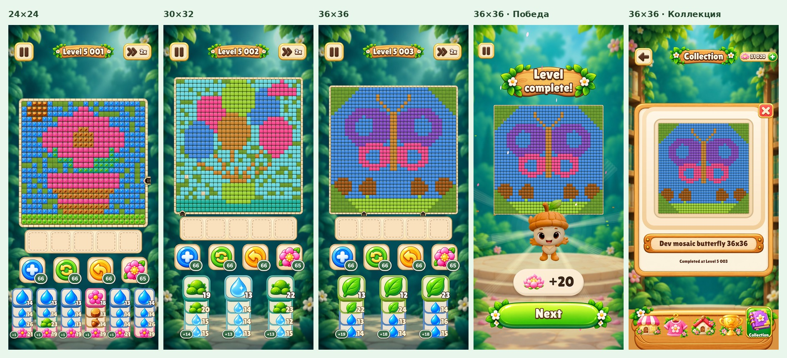

# Large-board support · 2026-10-15

24×24, 30×32 and 36×36 are working formats up to 1296 cells. These pictures are engineering fixtures, not new approved
launch art. Original screenshots were rendered at 1080×1920, 1080×2340 and 1080×2520; this JPEG is a compact review
sheet of the 19.5:9 renders. No artwork is painted over the boards.

Checked:

- 2704 core/content/solver/generator/pipeline tests passed, including JSON/schema boundaries, complete wins, loss
  witnesses, pack/loading round trips and deterministic generation of the 36×36 fixture.
- Additional generated 36×36 Hard/Super Hard regression examples pass the release validator and score
  recomputation: 4437/4572 points, peak buffer 3/4. Their source-order tuning keeps both class and pressure targets.
- Combined validation: three solved levels, zero errors; three existing provisional readability warnings.
- Combined score: all three stored scores/classes agree with recomputation.
- Playtest animator: 160 normal/rapid replays passed, now including wins/jams for all three large sizes.
- Unity engine-free timeline checks passed with the same extra large-board traces.
- 15 actual screen renders passed: gameplay for three sizes, 36×36 win, 36×36 earned collection detail, at three phone
  shapes. Navigation-loading and live-effect-loading checks also passed.
- Both Android projects compile without packaging an APK. Asset-item checks keep the production build at 2500 levels
  with zero development pictures; the tester includes all three extra levels and pictures.
- Existing art-pilot definitions and solver records reproduce byte for byte after the extension.
- On-device/Unity Editor execution was not performed here.

The full Unity-stub client suite passed 473/476 tests. Three existing checks fail identically on the unmodified
`2d049cfd` source snapshot (including its original 22×28 core), built separately outside the checkout:
`ReferenceLayoutTests.TheWinScreen_StacksSignPictureHeroRewardAndNext`,
`TrayGridTests.PodGrid_InTheTrayArea_IsTheReferenceGrid`,
`UiKitPictureTests.TheStoneBorder_RingsTheGrid_WithCornersAndRuns`.
Their baseline errors concern the win background's pedestal anchor, tray row spacing and stone-corner recipe order.
No new large-board test failed; those unrelated existing issues were not changed in this patch.

[Local generation recipes and fixture sources](../../../content/pictures/dev/README.md).
