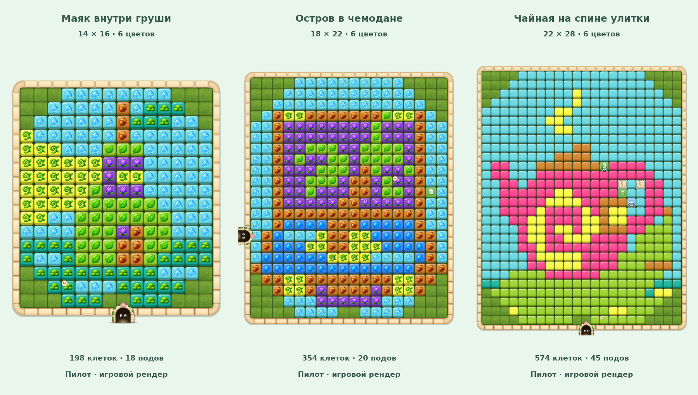

# Story mosaic pilot · 2026-10-15

Three independently authored grids, **3 / 2500** unique compositions. Each has one target size; these are not
resize variants. The screenshot is rendered with the current `BoardPainter.Draw`, including actual tile styles,
entries and generated overlays. No painted illustration is substituted over the playable cells.

The current small/medium-board tile icons compete with the story silhouette; the large board reads more clearly.
This is a readability finding from the pilot, not a claim that the art is already approved for production.
The concept sheet is an art reference, not the game's exact tile output.

[Sources, solved samples and local reproduction instructions](../../../content/pictures/pilot/README.md).

All three samples are solvable and losable, have matching difficulty scores, and reproduce byte for byte through
`tools/catalog/build-art-pilot.ps1 -Render`. They are kept outside production packaging. No APK was built.
